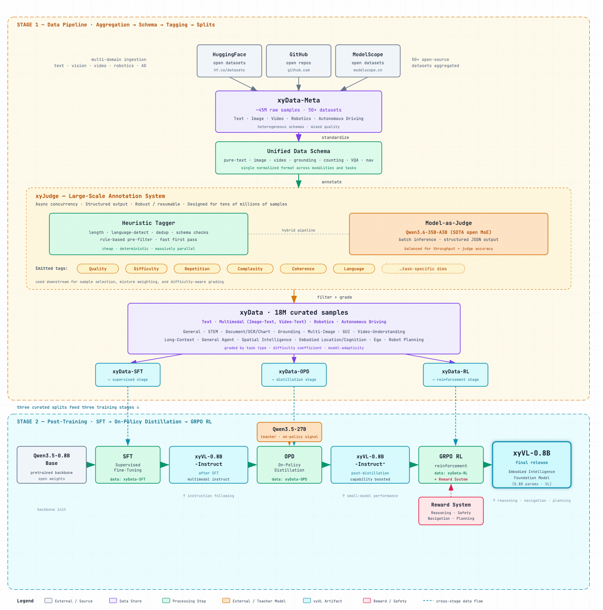
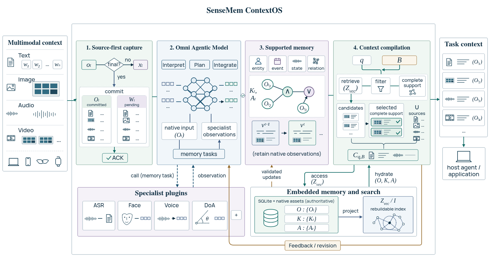
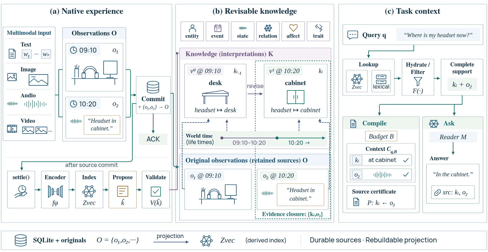

# About

I am **Xin Yan (颜鑫)**, an engineer specializing in **multimodal models, agent systems and embodied intelligence**. As a **Senior Algorithm Engineer at Cylingo Group (测测)**, I lead **robotics algorithm architecture** and development of the **xyVL embodied vision-language model series**. Previously, I led the **Xinyuan series of domain-specific models**. I graduated in Automation from **East China University of Science and Technology**.

I connect **model development, system architecture and product engineering**, taking work from data curation, training and evaluation through product design and deployment. I translate application needs into technical decisions and use evaluation and user feedback to guide iteration. Those decisions balance model capability, compute, inference latency and long-term maintenance.

My long-term focus is **AI that interacts with people over time**: systems that understand context, remember shared experiences and update their judgments as new information arrives. My current projects put that direction into practice: **SenseMem** for agentic multimodal memory, **FateBridge** for traditional metaphysics and astrology computation, and **QianYe** for family memory and shared storytelling.

Literature shapes how I understand people and informs my approach to affective intelligence and product experience. Through **open-source projects, teaching, writing and [public talks](#talks-media-en)**, I share methods and engineering experience that others can use and build on.

# News

* *2026.05*: Co-authored *LangChain Large Model Application Development: From Beginner to Practice*, published by Tsinghua University Press.
* *2026.01*: First Prize in the 2025 Synthetic Data Competition · Lingxi AI for Mental Health track, with the MindChat team · [report](https://www.shobserver.com/wx/detail.do?id=1047568).
* *2025.09*: Speaker at the 2025 Apsara Conference session "Doing AI, the Gen-Z Way".
* *2025.07*: Bronze Award in the 2024 China International College Students' Innovation Competition.
* *2025.07*: Joint interview by Alibaba Cloud Tongyi Lab and ModelScope · [podcast](https://www.xiaoyuzhoufm.com/episode/6878c7f5a9dec92500c5c93e).

# Experience

**Cylingo Group (测测) | Senior Algorithm Engineer** 
*January 2026 - Present*

xyVL

**[Cylingo Robotics: xyVL Embodied Vision-Language Model Series](/images/xinyan-robot-xyvl-pipeline.png)**

I lead algorithm architecture for **Cylingo Robotics (心言机器人)** and development of the **xyVL embodied vision-language model (VLM) series**, building a development pipeline across **multimodal data curation, automated quality assessment and post-training**.

**xyData: Multimodal Data Curation.** I brought together **50+ open-source datasets with approximately 45 million raw samples** from Hugging Face, GitHub and ModelScope, covering text, images, video, robotics and autonomous driving. Schema normalization, quality filtering and difficulty grading produced **18 million curated samples**. I designed data mixtures around task distribution, difficulty and model suitability for SFT, distillation and reinforcement learning.

**xyJudge: Model-as-a-Judge Evaluation and Annotation.** I combined heuristic checks for sample length, language, duplication and schema compliance with **Qwen3.6-35B-A3B** judgments of quality, difficulty, repetition, complexity and coherence. Asynchronous concurrency and resumable processing support evaluation and annotation across tens of millions of samples.

**Multimodal Post-training: SFT → On-Policy Distillation (OPD) → GRPO.** I build on **Qwen3.5** with a staged training pipeline: multimodal instruction tuning, on-policy distillation from **Qwen3.5-27B**, and GRPO with rewards for reasoning, safety, navigation and planning. This work targets environmental understanding and embodied task capabilities.

**Cylingo Group (测测) | Senior Algorithm Engineer** 
*March 2024 - January 2026*

I led the **Xinyuan series of domain-specific models** from data curation through training, evaluation and deployment. The work covered multi-source multimodal data, continual pre-training, SFT, RLHF and multidimensional evaluation. I coordinated algorithm and engineering teams of **5–20 people** and delivered selected open-source releases. The series has accumulated **20,000+ downloads** across Hugging Face and ModelScope.

For psychological support, education and companionship, I made **conversational continuity, affective expression, knowledge grounding and domain adaptation** priorities for training and evaluation. Failure analysis and user feedback guided improvements. I aligned model and deployment choices with product needs, balancing domain performance, general capabilities, inference latency, ecosystem support and maintenance costs.

Selected work:

* [Xinyuan-LLM-14B-0428](https://huggingface.co/Cylingo/Xinyuan-LLM-14B-0428): Domain training on Qwen3-14B-Base for psychological support and education, with model weights and deployment instructions.
* [Xinyuan-VL-2B](https://huggingface.co/Cylingo/Xinyuan-VL-2B): Based on Qwen2-VL-2B-Instruct and trained on **5M+ multimodal samples**, with gains over the base model on multiple visual-understanding benchmarks. Ranked **first in the <4B parameter category** on the OpenCompass & Hugging Face Open VLM Leaderboard in **September 2024**. See the model card for training and evaluation details and the [ModelScope event report](https://developer.aliyun.com/article/1664742) for coverage of the result.
* Presented "Open Source Technology Driving Pan-Psychological Services and AI Inclusion" at the **ModelScope Developer Co-Creation Event** and joined a [Tongyi Lab × ModelScope interview](https://mp.weixin.qq.com/s/a16sWs_QPtvoeY4J5eexTg) on model selection, evaluation, personalization and on-device deployment.

# Selected Projects

<figure class="project-figure">
  
  <figcaption>ContextOS Overview<a href="https://github.com/SenseMem/SenseMem/blob/master/docs/context-os.md" aria-label="SenseMem technical report, Figure 1">Fig. 1 ↗</a></figcaption>
</figure>
<figure class="project-figure">
  
  <figcaption>Memory Lifecycle<a href="https://github.com/SenseMem/SenseMem/blob/master/README.md" aria-label="SenseMem technical report, Figure 2">Fig. 2 ↗</a></figcaption>
</figure>

**[SenseMem: Agentic Multimodal Memory](https://github.com/SenseMem/SenseMem)**

**Vision & Design.** I created SenseMem as a unified **Omni-modal Memory & Context Layer** for **agentic harnesses, personal assistants and embodied interaction**. It connects the context and shared experiences accumulated over time with the task an agent faces now. Its design follows the **3S** principles: **Smarter** pursues more useful context through memory formation, revision and recall. **Swifter** makes capabilities easier to compose, models easier to select and integrations easier to extend. **Stronger** targets broader deployment environments and leading quality across modalities and tasks.

I lead the design and implementation of the **Memory Kernel**, unifying text, images, audio, video and their ordered combinations in one content contract. The kernel connects source observations, evolving knowledge and task context while managing evidence, identity, time, space and versions. Optional models support memory formation; auditable, reversible operations handle consolidation, correction, reinforcement and cognitive forgetting. **Hybrid Retrieval** combines dense and lexical search with temporal, spatial and identity constraints and optional semantic reranking. The **Context Compiler** assembles memory and supporting evidence within item, character and media budgets, reports conflicts and information gaps, and supplies citations for grounded answering. SQLite and original media preserve authoritative state, while Zvec provides a rebuildable index. Typed contracts connect local or remote embedding, generation, speech, vision and memory-processing models. SDK, REST, MCP and CLI interfaces share the kernel and integrate with the host harness's goals, scheduling and actions.

SenseMem achieves **state-of-the-art results** on memory benchmarks including **MOSAIC, Mem-Gallery, ATM-Bench and LoCoMo-Refined**. **MOSAIC** evaluates omni-modal memory across text, images, audio and video. **Mem-Gallery** addresses visual personal memory and image-grounded dialogue. **ATM-Bench** tests retrieval and reasoning over heterogeneous personal archives, including email, images and video. **LoCoMo-Refined** evaluates long-term memory across multiple dialogue sessions. Together, these results show **broad capability and leading performance across memory scenarios**, from omni-modal interaction and personal media to long-running conversations.

**[FateBridge: A Traditional Metaphysics and Astrology Engine for Agentic Harnesses](https://github.com/thomas-yanxin/FateBridge)**

I created FateBridge, a local **domain computation engine** for **agentic harnesses**. It turns traditional metaphysics and astrology rules into callable, inspectable tools. The engine supports the host agent's workflow from understanding a question to invoking calculations and explaining the results.

The project integrates **92 MCP tools**, including BaZi, Zi Wei Dou Shu and Western astrology, alongside CLI and REST API access. A unified tool catalog, schema validation and shared execution layer reuse domain services and calculation kernels. Structured results, time conventions and run metadata support provenance tracking and delivery within response budgets.

I make **calendar and solar-term boundaries, time zones, true solar time and differences between rule traditions** core engineering concerns. Algorithm regressions, independent references and cross-interface checks examine the calculation implementation. The system records input conditions and validation scope, and distinguishes calculations, traditional interpretations and practical suggestions to support traceable explanations.

**QianYe (亲百问): Family Memory and Shared Storytelling**

I contribute to **product design and WeChat mini program development** for QianYe, a public-interest product for **family memory and collaborative storytelling**. Photographs, familiar objects and voices prompt relatives to share stories asynchronously, creating a memory journal they can review and read together.

A native WeChat mini program, CloudBase functions and shared business modules connect recording, ASR transcription and optional LLM editing in a storytelling, review and journal workflow. Asynchronous jobs handle transcription and content processing. Segmented saving and draft recovery let people resume their stories, while larger text and clear interaction states support older adults.

The product centers the storyteller: original audio, images and transcripts remain available, and users can publish the original transcript or choose and review an AI-edited version. Family spaces and invitations manage reading and contribution permissions, giving storytellers and their relatives control over how their stories are told and shared.

**[Health LLM Knowledge Platform: MindChat & Sunsimiao](https://github.com/X-D-Lab)**

MindChat grew from a conversation with my teacher about family companionship into a **domain-specific LLM** project for psychological dialogue and medical knowledge. I was responsible for **model training** and collaborated with the team on data construction, model evaluation and application integration.

My work covered domain data cleaning, domain adaptation and instruction tuning, alongside exploration of retrieval, memory and context management in multi-turn dialogue. I evaluated conversational continuity, knowledge grounding and capability boundaries to connect domain training with practical dialogue needs.

The team released [MindChat](https://github.com/X-D-Lab/MindChat) and [Sunsimiao](https://github.com/X-D-Lab/Sunsimiao), including models, inference examples and deployment materials. This work built experience in domain training, dialogue evaluation and application integration that later informed my design of agentic memory systems.

**[ColugoMum: Smart Retail Settlement Platform](https://github.com/thomas-yanxin/ColugoMum)**

I was responsible for **project management, algorithm adaptation and on-device frontend development** for ColugoMum, an **image-retrieval-based** smart retail checkout platform. The work addressed product recognition, similar packaging and a continuously changing catalog.

Using **PaddleClas / PP-ShiTu**, I built datasets, tuned lightweight models and integrated cloud, edge and frontend components. Incremental retrieval-gallery updates introduced new categories with less repeated training. I adapted the application for limited samples, similar packaging and on-device inference latency.

The project received the **National First Prize at the 2022 China Robot and Artificial Intelligence Competition**, appeared at **Baidu Wave Summit 2021+**, and led to a [paper](https://ieeexplore.ieee.org/document/9851085), open-source code and teaching materials. Methods and experiments are described in the [technical article](https://developer.cloud.tencent.com/article/2146677).

**[OXiaoPeng: A Model Application Built from Community Needs](https://github.com/thomas-yanxin/OXiaoPeng)**

OXiaoPeng is a **conversational AI application** for WeChat communities. It began with advertisement moderation, member welcomes and common-question answering. I then integrated ERNIE, PanGu, Yuan, ChatYuan and ChatGPT, bringing conversation and text-to-image services into everyday community use. Both its requirements and its name came from the community.

I handled **model API integration, feature development and service maintenance**, turning user feedback into product improvements. When an upstream API change interrupted image generation, I addressed dependency adaptation and service recovery, gaining experience in sustaining an AI application for real users.

Early deployments served **2,000+ direct users**, with an **indirect reach of 20,000+ people**, across several AI open-source communities. The project received an **OpenI project incubation award in 2022** and was shortlisted for an **interview for the 2023 MiraclePlus Spring Camp (S23)**. ["2022, My Year with OpenI"](https://www.cnblogs.com/thomas-yanxin/p/17067454.html) records the project's growth and the community's role.

# Publications & IP

* Tao Zhou, Dong Xue, **Xin Yan**. *LangChain Large Model Application Development: From Beginner to Practice*. Tsinghua University Press, 2026.
* D. Xue, J. Tu, M. Wang, **X. Yan**, F. Liu and J. Hu, "[Towards Privacy-Preserving Mental Health Support with Large Language Models](https://arxiv.org/abs/2601.01993)," *arXiv preprint* arXiv:2601.01993, 2026.
* F.-Q. Cui, J. Huang, S. Zhao, J.-M. Guo, Q. Cai, **X. Yan** and Z. Liu, "[ReMA: A Training-Free Plug-and-Play Mixing Augmentation for Video Behavior Recognition](https://arxiv.org/abs/2601.00311)," *arXiv preprint* arXiv:2601.00311, 2026.
* F.-Q. Cui, J. Huang, S. Zhao, X. Li, **X. Yan**, Z. Jia and X. Zhou, "[Robust Low-Rank Sparse Framework for Video-Based Affective Computing](https://arxiv.org/abs/2511.11406)," *arXiv preprint* arXiv:2511.11406, 2025; revised 2026.
* **X. Yan**, Q. Hu, X. Huang and C. Shen, "[Intelligent Retail Settlement Platform based on Image Retrieval](https://ieeexplore.ieee.org/document/9851085)," CISCE, 2022, pp. 609–616. doi: 10.1109/CISCE55963.2022.9851085 · [PDF](/proof/Intelligent_Retail_Settlement_Platform_based_on_Image_Retrieval.pdf).
* Utility Model Patent: **Smart Retail Settlement Platform**, ZL 2022 2 0828888.8; CN 216979871 U · [certificate](/proof/专利-2022208288888智能零售结算平台.pdf).
* Software Copyrights: **ColugoMum**, 2022SRE010935 · [certificate](/proof/软件著作权-袋鼯麻麻.jpg); **Intelligent Waste Sorting System**, 2021SR0986633 · [certificate](/proof/软件著作权-慧眼识垃圾.jpg); **Domain-Knowledge-Based Q&A System**, 2022SRE025369 · [certificate](/proof/软件著作权-自动问答.pdf).

# Talks & Media

I speak at technical conferences, developer events and courses on **model selection, evaluation and application development**. In public interviews, I also discuss how literature, affective intelligence and product design inform my technical work.

## Invited Talks

* *2025.09*: Speaker, Apsara Conference, "Doing AI, the Gen-Z Way".
* *2025.05*: ModelScope Developer Co-Creation Event, "Open Source Technology Driving Pan-Psychological Services and AI Inclusion".
* *2023.06*: PaddlePaddle LLM Application Development Course, "Building an Intelligent Document Query Assistant" · [video](https://www.bilibili.com/video/BV18h4y1d77H/).
* *2023.05*: Datawhale AIGC Learning Program, "Building a Local Knowledge Base QA Application with LangChain and ChatGLM-6B" · [video](https://www.bilibili.com/video/BV11N411y7dT/).
* *2022.04*: PaddlePaddle Industry Practice Library, "Product Recognition in Practice" · [video](https://www.bilibili.com/video/BV1Fu411y7co/).

## Media Coverage

* **Alibaba Cloud Tongyi Lab × ModelScope: "Writing Code, Writing Emotions"** (2025) · [article](https://mp.weixin.qq.com/s/a16sWs_QPtvoeY4J5eexTg), [short video](https://www.bilibili.com/video/BV1GVgNzLEHs/), [full podcast · 47:52](https://www.xiaoyuzhoufm.com/episode/6878c7f5a9dec92500c5c93e). 
  On my interest in affective intelligence, literature's influence on how I understand people, and evaluation as a guide to model improvement. Listening guide: **20:21** literature-related exploration, **29:28** affective intelligence and evaluation, **36:26** base-model selection.
* **Founder Park: Model Selection and Product Development** (2025) · [original article](https://mp.weixin.qq.com/s/pb8eoQhvAF9O5N3CSO7rIg), [interview transcript reprint](https://news.sina.com.cn/sx/2025-04-30/detail-ineuxrwv4808216.shtml). 
  A discussion of emotional cues lost in speech transcription, the balance between domain and general abilities during post-training, and how cost, ecosystems and product workflows shape technical choices.
* **ScienceNet / China Science Daily: The Origins of MindChat** (2023) · [article](https://news.sciencenet.cn/htmlnews/2023/12/513458.shtm). 
  An early account of how a discussion about family companionship led to MindChat, with reflections on continued model development, ecosystems and fit with the intended use.

More coverage and earlier public work

* Tongyi Qwen, "Qwen + Mental Health = ?" · [record](https://mp.weixin.qq.com/s/ZcRES0s7zD_yDeWTTr6Gyg).
* Synced SOTA Models, new releases of MindChat and related models · [record](https://mp.weixin.qq.com/s/PppVdSHObBG7IRA-vgVLlA).
* Synced SOTA Models, quarterly review of open-source foundation models, domain tuning, inference acceleration and agents · [record](https://mp.weixin.qq.com/s/ApOMU6qRfYopCW0NkUCQCQ).
* OpenMMLab, "Feeling Low? Try the MindChat Psychological Model" · [record](https://mp.weixin.qq.com/s/wOQP2A0nm0OGaiwzdJ9wPg).
* ModelScope, release of MindChat based on Qwen-7B · [record](https://mp.weixin.qq.com/s/frJwp-kLuF_aT_vt8V6hJQ).
* GitHubStore, introduction to MindChat · [record](https://mp.weixin.qq.com/s/OIHSBq6c-4QAxvDUqmgpFA).
* OpenI, results of the 2022 outstanding project and developer selection · [record](https://mp.weixin.qq.com/s/PpbwEdP0-8wG9dsvRvRDaA).
* OpenI, university open-source event · [record](https://mp.weixin.qq.com/s/phDFWZ8YOYEJMoYNrsOrag).
* PaddlePaddle, supporting Hefei University of Technology's affective computing team in the national "Internet+" Silver Award · [record](https://mp.weixin.qq.com/s/SgK9qSmYQ9ihIfvb1sHEwA).
* Group Learning, "We Built a Smart Retail Settlement Platform" · [record](https://mp.weixin.qq.com/s/Ons9jLOekpbTPfcjW87Q3Q).
* OpenI, profile of a developer featured for four consecutive weeks · [record](https://mp.weixin.qq.com/s/vgsMagmEVbcsXBVqil9_5A).
* Datawhale, "We Built a Smart Retail Settlement Platform" · [record](https://mp.weixin.qq.com/s/V8eBkYZvb-mNJtyez7n_Rg).
* OpenI, recommended open-source project: ColugoMum · [record](https://mp.weixin.qq.com/s/mgNcoWAICBAqkPCqqBN8Iw).
* PaddlePaddle, welcoming 17 developers to the PPDE program · [record](https://mp.weixin.qq.com/s/PAeREjahNTSJmwn1QtI3Zg).
* Taiyuan University of Technology Internet PLUS Platform, PaddlePaddle Campus Fest · [record](https://mp.weixin.qq.com/s/-VoCDzr1MjeGm4UQuRxORw).
* Anhui Polytechnic University, first AI Innovation Festival · [record](https://mp.weixin.qq.com/s/oCVRHA5Hg41PqTQ-yJQgkg).
* PaddlePaddle, developing the Intelligent Waste Sorting mini program · [record](https://mp.weixin.qq.com/s/6xt4ReF-n4qyJ859yvCbcg).
* Machine Learning and AI Algorithms, Intelligent Waste Sorting system · [record](https://mp.weixin.qq.com/s/rsJSLKaNxtJ06HnwbWbL-w).
* *2021.07*: PaddlePaddle AI Creator Camp (course-series collection) · [record](https://www.bilibili.com/video/BV1qq4y1X7uZ/).
* *2021.05*: PaddlePaddle Developer Talks, "Intelligent Waste Sorting" · [record](https://www.bilibili.com/video/BV13p4y1t76K/).

# Community & Activities

I contribute to **open-source projects, technical education and developer communities**, turning engineering experience into practical courses and projects. University programs, community collaboration and ongoing maintenance connect that work with developers, users and new collaborators.

**[PaddlePaddle Navigator Group](https://www.paddlepaddle.org.cn/ppdenavigategroup) | East China Regional Lead** 
*September 2021 - July 2022*

* Coordinated operations across **seven provinces** in East China, including university outreach, local lead recruitment, events and project activities. Expanded coverage to **50+ universities**, including Zhejiang University, Southeast University, ShanghaiTech and ECUST.

**[ECUST PaddlePaddle Navigator Group](https://www.paddlepaddle.org.cn/ppdenavigategroup) | Lead** 
*April 2021 - January 2022*

* Built the university group from scratch, organizing **5+ activities** with **100+ total attendances** and supporting **10+ projects** through lectures, competitions and practical sessions.
* Helped turn community practice into course resources through the Baidu–ECUST industry-education collaboration project.

More community and education activities

* 2022: Member of OpenI's first cohort of senior community experience officers.
* 2022: Student coordinator for collaboration between OpenI and Hefei University of Technology's affective computing laboratory · [record](/proof/OpenI&MAC_LAB.jpg).
* 2022: Co-developed PaddlePaddle's retail recognition industry case · [record](https://www.bilibili.com/video/BV1Fu411y7co/).
* 2022: Guest speaker at ECUST's Tonghai Tea Talk, No. 130 · [record](https://mp.weixin.qq.com/s/yyOjg0qnRo8TggylMhyqgA).
* 2022: Learning facilitator for Datawhale's 34th group-learning program · [record](https://mp.weixin.qq.com/s/8NAmTy5n7TXxVH85WAR-gA).
* 2022: Instructor, second PaddlePaddle AI Creator Camp · [record](https://mp.weixin.qq.com/s/JfHYZZE701Qt7vJJa1K11w).
* 2021: Instructor, first PaddlePaddle AI Creator Camp · [record](https://mp.weixin.qq.com/s/MD-ni4z5EITpdrAZd2FGyg).
* 2021: Shanghai PaddlePaddle Navigator Group × Wujiaochang Innovation and Entrepreneurship Academy meetup · [record](https://mp.weixin.qq.com/s/NMJVAttPUHiZEaIIz1zQoA).

# Awards & Honors

## Featured Awards

* **First Prize**, 2025 Synthetic Data Competition · Lingxi AI for Mental Health, with the MindChat team · [report](https://www.shobserver.com/wx/detail.do?id=1047568).
* **Bronze Award**, 2024 China International College Students' Innovation Competition, driver-state monitoring and edge computing project.
* **Bronze Award**, 2023 China International "Internet+" Innovation Competition, Lingxin Intelligence.
* **Silver Award**, 2022 China International "Internet+" Innovation Competition, Xiaosheng Technology · [record](https://mp.weixin.qq.com/s/EujzF8ubT_1PkoMs3u-qTw).
* **National First Prize**, 2022 China Robot and Artificial Intelligence Competition · [certificate](https://github.com/thomas-yanxin/thomas-yanxin.github.io/blob/master/proof/2022%E5%B9%B4%E7%AC%AC24%E5%B1%8A%E4%B8%AD%E5%9B%BD%E6%9C%BA%E5%99%A8%E4%BA%BA%E5%8F%8A%E4%BA%BA%E5%B7%A5%E6%99%BA%E8%83%BD%E5%A4%A7%E8%B5%9B%E5%85%A8%E5%9B%BD%E4%B8%80%E7%AD%89%E5%A5%96.pdf).

## Selected Honors

* Baidu PaddlePaddle Developer Expert (PPDE) · [record](https://www.paddlepaddle.org.cn/ppdemd?n=/ppdemd/%E9%A2%9C%E9%91%AB).
* OpenAtom Foundation Active Open Source Contributor.
* Baidu AIStudio **2022 Top 10 Influential Figures** · [record](https://mp.weixin.qq.com/s/jKTEAP1euh4yBoatod9E0Q).
* OpenI Community Core Early Experience Officer.
* Datawhale member · [record](https://mp.weixin.qq.com/s/_I-aNX1lAPV2_eYoS0w_Bg).
* Qwen Ambassador.

More awards and recognition

* 2024: **Gold Award**, Anhui College Students' Innovation and Entrepreneurship Competition, industry track, AI-enabled civil-military applications.
* 2023: **Gold Award**, 9th Anhui "Internet+" Competition, Lingxin Intelligence.
* 2022: **Gold Award**, 8th Anhui "Internet+" Competition, Xiaosheng Technology · [record](https://github.com/thomas-yanxin/thomas-yanxin.github.io/blob/master/proof/%E3%80%90%E6%99%93%E5%A3%B0%E7%A7%91%E6%8A%80%E3%80%91%E5%AE%89%E5%BE%BD%E7%9C%81%E9%87%91%E5%A5%96.pdf).
* 2022: **Silver Award**, 8th Jiangsu "Internet+" Competition, Jingxuan Future · [record](https://github.com/thomas-yanxin/thomas-yanxin.github.io/blob/master/proof/%E7%AC%AC%E5%85%AB%E5%B1%8A%E6%B1%9F%E8%8B%8F%E7%9C%81%E2%80%9C%E4%BA%92%E8%81%94%E7%BD%91%2B%E2%80%9D%E5%A4%A7%E5%AD%A6%E7%94%9F%E5%88%9B%E6%96%B0%E5%88%9B%E4%B8%9A%E5%A4%A7%E8%B5%9B_%E8%B7%AF%E6%BC%94%E9%A1%B9%E7%9B%AE%E8%AF%84%E5%AE%A1%E7%BB%93%E6%9E%9C%E5%8F%91%E5%B8%83%E7%89%88%E6%9C%AC%20.pdf).
* 2022: **Silver Award**, 8th Shanghai "Internet+" Competition, Medbio · [record](https://github.com/thomas-yanxin/thomas-yanxin.github.io/blob/master/proof/Medbio-%E6%B4%BB%E6%80%A7%E5%B0%8F%E5%88%86%E5%AD%90%E5%8C%96%E5%90%88%E7%89%A9%E7%A7%91%E7%A0%94%E6%9C%8D%E5%8A%A1%E5%B9%B3%E5%8F%B0.pdf).
* 2022: **Top 10**, 7th Maker China Competition, Baidu track, Jingxuan Future · [record](https://mp.weixin.qq.com/s/kAp6jfZpvG2eolcWSANHSQ).
* 2022: **Bronze Award**, 13th Shanghai Challenge Cup, ColugoMum · [record](https://github.com/thomas-yanxin/thomas-yanxin.github.io/blob/master/proof/2022%E5%B9%B4%E6%8C%91%E6%88%98%E6%9D%AF%E5%B8%82%E7%BA%A7%E5%A4%8D%E8%B5%9B%E7%BB%93%E6%9E%9C-%E5%8D%8E%E4%B8%9C%E7%90%86%E5%B7%A5%E5%A4%A7%E5%AD%A6.pdf).
* 2022: **Gold Award**, 10th ECUST Fenjin Cup, ColugoMum · [record](https://mp.weixin.qq.com/s/WgE9zxD4Nv4H-f_2sXr5pw).
* 2022: **First Prize**, 8th Nanjing University of Finance and Economics "Internet+" Competition, Shuju Fengchao.
* 2022: **First Prize**, 8th ECUST "Internet+" Competition, ColugoMum.
* 2022: **Second Prize**, first Hefei University of Technology Intelligent Cup, Xiaosheng Technology · [record](/proof/首届合肥工业大学”智能杯“创新创业大赛大创组二等奖.jpg).
* 2022: **National Third Prize**, 15th China College Students' Computer Design Competition, software development · [record](https://github.com/thomas-yanxin/thomas-yanxin.github.io/blob/master/proof/2022%E5%B9%B4%EF%BC%88%E7%AC%AC15%E5%B1%8A%EF%BC%89%E4%B8%AD%E5%9B%BD%E5%A4%A7%E5%AD%A6%E7%94%9F%E8%AE%A1%E7%AE%97%E6%9C%BA%E8%AE%BE%E8%AE%A1%E5%A4%A7%E8%B5%9B%E4%B8%89%E7%AD%89%E5%A5%96.pdf).
* 2022: **National Third Prize**, 15th China College Students' Computer Design Competition, Internet of Things · [record](https://github.com/thomas-yanxin/thomas-yanxin.github.io/blob/master/proof/2022%E5%B9%B4%E7%AC%AC15%E5%B1%8A%E4%B8%AD%E5%9B%BD%E5%A4%A7%E5%AD%A6%E7%94%9F%E8%AE%A1%E7%AE%97%E6%9C%BA%E8%AE%BE%E8%AE%A1%E5%A4%A7%E8%B5%9B%EF%BC%88%E7%89%A9%E8%81%94%E7%BD%91%E7%BB%84%EF%BC%89%E5%85%A8%E5%9B%BD%E4%B8%89%E7%AD%89%E5%A5%96.jpg).
* 2022: **First Prize**, 24th China Robot and Artificial Intelligence Competition, Shanghai regional AI innovation event · [record](https://github.com/thomas-yanxin/thomas-yanxin.github.io/blob/master/proof/%E7%9B%96%E7%AB%A0%E5%85%AC%E7%A4%BA-%E4%B8%8A%E6%B5%B7%E8%B5%9B%E5%8C%BA%E6%8B%9F%E8%8E%B7%E5%A5%96%E5%90%8D%E5%8D%95%E5%85%AC%E7%A4%BA%E7%9A%84%E9%80%9A%E7%9F%A5.pdf).
* 2022: **Second Prize**, 5th China Collegiate Computing Competition, AI creativity, East China regional event.
* 2022: **Second Prize**, 14th Shanghai Computer Application Design Competition, software development.
* 2022: **Second Prize**, 14th Shanghai Computer Application Design Competition, Internet of Things.
* 2022: OpenI **Community Pioneer Award** and **Outstanding Project Incubation Award** · [record](https://mp.weixin.qq.com/s/rEXoEY1UbEgwolYE-OJPjw).
* 2022: **First Place**, OpenI outstanding open-source project selection, ColugoMum · [record](/proof/%E8%A2%8B%E9%BC%AF%E9%BA%BB%E9%BA%BB.png).
* 2022: **Second Place**, OpenI outstanding open-source project selection, OXiaoPeng · [record](/proof/%E6%AC%A7%E5%B0%8F%E9%B9%8F.png).
* 2022: **Annual Top 10 Applications**, iFlytek Open Ecosystem AI Pioneer Application Awards · [record](https://mp.weixin.qq.com/s/P6VaXjlXWLT0JGvBFRDIvQ).
* 2022: **Winning Team**, second Diankuan Cup National University Fintech Hackathon · [record](https://mp.weixin.qq.com/s/0nwc8CRLXZZaJnAg6JJjVA).
* 2021: **Second Prize**, 23rd China Robot and Artificial Intelligence Competition, Shanghai regional AI innovation event.
* 2021: PPSIG **Outstanding Open Source Project Award** · [record](/proof/PPSIG%E5%A5%96%E6%9D%AF.jpg).
* 2021: PaddlePaddle Hackathon **Outstanding Open Source Project Award** · [record](/proof/%E9%A3%9E%E6%A1%A8%E9%BB%91%E5%AE%A2%E6%9D%BE.jpg).
* 2021: Wave Summit 2021+ **Outstanding Open Source Project** · [record](/proof/WS%E4%BC%98%E7%A7%80%E5%BC%80%E6%BA%90%E9%A1%B9%E7%9B%AE.jpg).
* 2022: Principal student investigator, National College Students' Innovation and Entrepreneurship Training Program, **Excellent** assessment · [record](https://cxcy.ecust.edu.cn/2023/1206/c14247a163409/page.htm).
* Intel Innovation Ambassador; Huawei Cloud Expert; member of CAAI and the Chinese Society of Astronautics; provisional member of the Chinese Association of Automation.
* 2022: Active contributor in the Jina community; expert blogger in Alibaba Cloud's developer community; active OpenI contributor and developer.
* PaddlePaddle Wave Summit 2021 / 2021+ Outstanding Open Source Developer.

# Education

**East China University of Science and Technology | School of Information Science and Engineering | Automation** 
*September 2019 - June 2023*

# Contact

For technical collaboration, project partnerships, speaking invitations or feedback on **multimodal models, agent systems, memory architectures and embodied intelligence**, contact [yx20001210@gmail.com](mailto:yx20001210@gmail.com). Find my open-source code and recent work on [GitHub](https://github.com/thomas-yanxin).

[← 中文](/)
