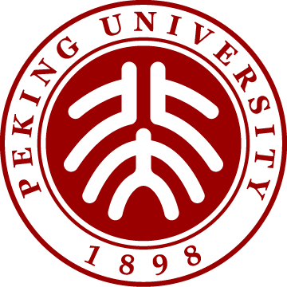
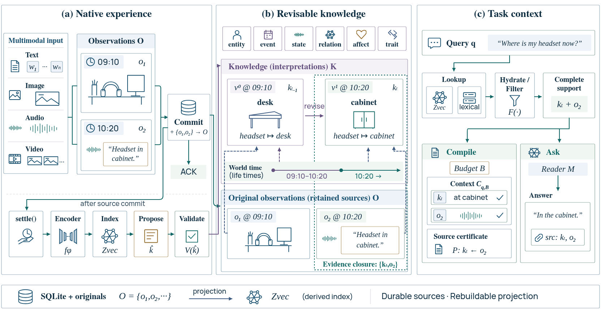

<section class="home-section home-section--about" aria-labelledby="about" markdown="1">



# 👋 About {#about}

I am **Xin Yan (颜鑫)** — creator, builder, researcher, and an **entrepreneur at heart**{: .key-accent}. My work centers on **sustained human–AI and embodied interaction**, applying **end-to-end co-design**{: .key-accent} across **product definition, multimodal data & rubrics, foundation model post-training, agentic harnesses, and evaluation** to turn frontier research into deployable systems.
{: .intro-lead}

As a **Senior Algorithm Engineer at XYRobot**, I lead **robotics algorithm architecture**, directing the **xyVL embodied native multimodal foundation models** alongside the **xyData** and **xyJudge** Rubrics System, and initiated **SenseMem**, an Agentic Omni-modal ContextOS achieving **SOTA**{: .key-accent} across MOSAIC and three other major memory benchmarks. Previously, I led a **5–20 person** team at **Cylingo Group** to ship the **Xinyuan** multimodal and domain model suite with **20,000+ downloads**, where **Xinyuan-VL-2B** ranked **#1 in the <4B category**{: .key-accent} on the OpenCompass & Hugging Face Open VLM Leaderboard. Earlier, I co-founded **X-D Lab**, open-sourcing **MindChat** and **Sunsimiao**. I hold a B.Eng. in Automation from **East China University of Science and Technology**.

My core research and engineering focus is **long-horizon human–AI symbiosis**: building embodied multimodal foundation models through **Data–Rubrics–Policy co-design**, advancing **Agentic Memory & Context Engineering** so agents continuously revise knowledge and compile task context across omni-modal streams, and grounding affective intelligence in full-duplex embodied interaction.

My MBTI type is **INTJ**. Literature sharpens how I read human nuance and grounds my instincts in affective intelligence and product taste.

As a **[Datawhale Member](https://mp.weixin.qq.com/s/_I-aNX1lAPV2_eYoS0w_Bg)**, **Qwen Ambassador**, and **Industry Mentor for Peking University's Xin Class**, I actively build open-source ecosystems and technical curricula. Open-source projects I have initiated or contributed to have earned **30,000+ GitHub Stars**{: .key-accent} in total, alongside a co-authored **Tsinghua University Press** book, publications in **IEEE TIFS and TCE**, and ongoing **[talks & media](#talks-media-en)**.

</section>

<section class="home-section home-section--news" aria-labelledby="news" markdown="1">

## 📰 News {#news}

* *2026.11* 📺 Featured in an exclusive interview on **Zhejiang TV**, sharing frontline work on embodied and affective AI \| 🎬 [Video](http://wap.cztv.com/tv/35/2991249.html).
* *2026.08* 🔥 Profiled in **Huozhong Shuo (火种说)** by **ModelBest & OpenBMB**, detailing the engineering behind **YRobot**{: .key-accent}, a full-duplex omni-modal desktop companion robot \| 📄 [Article](https://mp.weixin.qq.com/s/8pZUlvvhBve3G9CBNt_Q3Q).
* *2026.05* 📖 Co-authored *LangChain Large Model Application Development: From Beginner to Practice*, published by **Tsinghua University Press**{: .key-accent}.
* *2026.01* 🏆 **First Prize**{: .key-accent} in the 2025 Synthetic Data Competition, Lingxi AI for Mental Health track, with the **MindChat** team \| 📄 [Article](https://www.shobserver.com/wx/detail.do?id=1047568).
* *2025.09* 🎤 Invited Speaker at the 2025 Apsara Conference forum "Doing AI, the Gen-Z Way" \| 🎬 [Video](https://yunqi.aliyun.com/2025/session?agendaId=6012).
* *2025.07* 🥉 **National Bronze Award** in the 2024 China International College Students' Innovation Competition.
* *2025.07* 🎧 Joint in-depth interview with Tongyi Lab × ModelScope on affective intelligence, eval-driven iteration, and literature's influence on AI product judgment \| 🎧 [Podcast](https://www.xiaoyuzhoufm.com/episode/6878c7f5a9dec92500c5c93e).
{: .news-list role="list"}

</section>

<section class="home-section home-section--experience" aria-labelledby="experience" markdown="1">

## 💼 Experience {#experience}

<header class="experience-heading">
<h3 class="brand-heading">XYRobot (心言机器人) | Senior Algorithm Engineer</h3>

January 2026 - Present

</header>

<h4 class="project-title">🤖 <a href="/xyvl/?lang=en">xyVL: Embodied Native Multimodal Foundation Models</a></h4>

<figure class="project-figure project-figure--portrait">
  <iframe class="xyvl-embed" src="/xyvl/?lang=en&amp;embed=1" title="Animated xyData, xyJudge, and xyVL co-design" loading="lazy" width="560" height="440"></iframe>
</figure>

I lead core robotics algorithm architecture at **XYRobot (心言机器人)**, driving a closed-loop **Data–Rubrics–Model co-design**{: .key-accent} system uniting **xyVL** (embodied native multimodal foundation models), **xyData** (automated multimodal data curation), and **xyJudge** (a unified embodied **Rubrics System**). Co-designed around environmental understanding, spatial reasoning, safety alignment, navigation, and planning, xyData shapes the training distribution, xyJudge encodes quality gates and task objectives into executable rubrics, and xyVL realizes physical-world capabilities through staged multimodal post-training.

**xyData — End-to-End Automated Multimodal Data Engine.** Integrates **50+ open-source datasets (~45M raw samples)** from Hugging Face, GitHub, and ModelScope spanning text, image, video, robotics, and autonomous driving. Through automated ingestion, schema unification, quality gating, and difficulty stratification, distills **18M high-signal samples**{: .key-accent} into stage-aware **data mixtures** tailored for SFT, distillation, and reinforcement learning.

**xyJudge — Unified Embodied Rubrics System.** Translates data quality standards and embodied task specifications into structured **rubrics**, combining deterministic heuristic checks (length, language, deduplication, schema integrity) with **model-as-a-judge** evaluation via **Qwen3.6-35B-A3B** across quality, difficulty, redundancy, complexity, and coherence. Async concurrency and checkpoint recovery scale automated evaluation and annotation to **tens of millions of samples**, establishing a consistent baseline for xyData curation and post-training mixtures.

**xyVL — Embodied Native Multimodal Foundation Models.** Built atop **Qwen3.5** via a three-stage multimodal **post-training** pipeline: **SFT → On-Policy Distillation (OPD) → GRPO**{: .key-accent}. SFT grounds instruction following and embodied task execution; OPD leverages **Qwen3.5-27B** as a teacher over student-generated on-policy rollouts to eliminate exposure bias; GRPO optimizes task rewards for reasoning, safety, navigation, and planning — tightly co-designed with xyData mixtures and xyJudge rubrics.

<h4 class="project-title"> <a href="https://github.com/SenseMem/SenseMem">SenseMem: Agentic Omni-modal ContextOS</a></h4>

I initiated and architected **SenseMem**, an **Agentic Omni-modal ContextOS**{: .key-accent} serving as the persistent memory and **Context Engineering** substrate for **personal agents, agentic harnesses, and embodied interaction systems**. It transforms ongoing experiences across text, images, audio, and video into revisable, traceable memory under the **3S** architecture: **Smarter** (lifecycle memory formation, epistemic revision, and recall), **Swifter** (composable model backends and multi-protocol integration), and **Stronger** (cross-modal, cross-task generalization across edge-to-cloud deployments).

<figure class="project-figure">
  
  <figcaption>ContextOS Overview<a href="https://github.com/SenseMem/SenseMem/blob/master/docs/context-os.md" aria-label="SenseMem technical report, Figure 1">Fig. 1 ↗</a></figcaption>
</figure>

I lead the design and implementation of the **Memory Kernel**, defining a unified content contract over text, images, audio, video, and their ordered compositions with a **source-first** separation between immutable observations and derived knowledge. Grounded by identity, spatiotemporal, evidence, and version lineage, the kernel orchestrates models on demand for memory formation and evolves continuously through auditable, rollback-safe **consolidation, correction, reinforcement, and reversible forgetting**.

<figure class="project-figure">
  
  <figcaption>Memory Lifecycle<a href="https://github.com/SenseMem/SenseMem/blob/master/README.md" aria-label="SenseMem technical report, Figure 2">Fig. 2 ↗</a></figcaption>
</figure>

**Hybrid Retrieval** fuses dense retrieval, lexical search, spatiotemporal and entity constraints, and optional semantic reranking to recall task-relevant memories. The **Context Compiler** packs memories, raw media, and evidence closures within strict item, character, and media budgets — explicitly surfacing conflicts and knowledge gaps to support grounded reasoning.

**SQLite and native media** preserve authoritative state alongside a rebuildable **Zvec** index. Typed contracts decouple local and remote embedding, generation, speech, vision, and memory-processing models, while unified **SDK, REST, MCP, and CLI** interfaces share the kernel to connect memory and context operations with any host harness's goals, scheduling, and actions.

As of November 2026, SenseMem achieves **state-of-the-art (SOTA) performance**{: .key-accent} across four authoritative memory benchmarks: **MOSAIC** (omni-modal cross-session memory over text, images, audio, and video), **Mem-Gallery** (visual personal memory and image-grounded dialogue), **ATM-Bench** (retrieval and reasoning over heterogeneous personal archives including email, images, and video), and **LoCoMo-Refined** (multi-session long-term conversational memory).

<header class="experience-heading">
<h3 class="brand-heading">Cylingo Group (测测) | Senior Algorithm Engineer</h3>

March 2024 - January 2026

</header>

I led 0-to-1 R&D and delivery of the **Xinyuan** multimodal and domain foundation model suite, directing a **5–20 person** algorithm and engineering team across multi-source multimodal data curation, **continual pre-training, mid-training, SFT, and RLHF preference alignment**, multidimensional evaluation, and production deployment. Open-source releases in the series have accumulated **20,000+ downloads**{: .key-accent} across Hugging Face and ModelScope.

For psychological support, education, and companionship, I instituted an **eval-driven iteration loop** — translating multi-turn continuity, affective nuance, knowledge grounding, and domain safety into measurable training and evaluation dimensions guided by failure-mode analysis and live user feedback. Base-model selection and sizing systematically balanced domain gains, general capabilities, inference latency, ecosystem tooling, and serving cost.

Selected work:

* [Xinyuan-VL-2B](https://huggingface.co/Cylingo/Xinyuan-VL-2B): Built on Qwen2-VL-2B-Instruct with **5M+ multimodal samples** for on-device visual understanding; ranked **#1 in the <4B parameter category**{: .key-accent} on the OpenCompass & Hugging Face Open VLM Leaderboard (September 2024). See the [ModelScope event report](https://developer.aliyun.com/article/1664742) for coverage.
* [Xinyuan-LLM-14B-0428](https://huggingface.co/Cylingo/Xinyuan-LLM-14B-0428): Built on Qwen3-14B-Base with **100K+ psychological dialogues and 1M+ medical corpora** for high-empathy mental health and educational support, open-sourcing weights and deployment recipes.
* Delivered an invited talk, "Open Source Technology Driving Pan-Psychological Services and AI Inclusion," at the **ModelScope Developer Co-Creation Event**, and joined a [Tongyi Lab × ModelScope in-depth interview](https://mp.weixin.qq.com/s/a16sWs_QPtvoeY4J5eexTg) on base-model selection, eval loops, personalization, and edge deployment.

<header class="experience-heading">
<h3 class="brand-heading">X-D Lab | Co-founder</h3>

June 2023 - March 2024

</header>

#### 🐳 [Health LLM Knowledge Platform: MindChat & Sunsimiao](https://github.com/X-D-Lab) {#health-llm-knowledge-platform-mindchat--sunsimiao}

Born from a conversation with my mentor about family companionship, **MindChat** grew into an open-source suite of **psychological dialogue and medical knowledge models**. As **co-founder of X-D Lab**, I spearheaded **model post-training** and collaborated across million-scale domain data construction, evaluation design, and application integration.

Focusing on **domain adaptation and instruction tuning**, I trained multi-turn empathetic response and Socratic questioning across million-scale corpora (spanning 0.5B–14B models plus an English psychological evaluator) while exploring multi-turn **retrieval, memory, and context management** grounded in conversational continuity, factual evidence, and domain fit.

The team open-sourced [MindChat](https://github.com/X-D-Lab/MindChat) and [Sunsimiao](https://github.com/X-D-Lab/Sunsimiao) with weights, inference examples, and private deployment guides — featured by ScienceNet, Synced, and Qwen, and later winning First Prize in the 2025 Synthetic Data Competition, Lingxi AI for Mental Health track. Lessons from this work directly shaped the architecture of **SenseMem**.

</section>

<section class="home-section home-section--projects" aria-labelledby="selected-projects" markdown="1">



## 🛠️ Selected Projects {#selected-projects}

###  [FateBridge: A Deterministic Domain Computation Engine for Agentic Harnesses](https://github.com/thomas-yanxin/FateBridge) {#fatebridge-a-traditional-metaphysics-and-astrology-engine-for-agentic-harnesses}

I initiated and built **FateBridge**, a deterministic **local domain computation engine** for **agentic harnesses**. Solving LLM hallucination in complex calendrical and symbolic systems, it encodes traditional metaphysics and astrology into verifiable tools with strict input and output contracts so agents reason over exact, traceable computations.

The engine exposes **92 MCP tools**{: .key-accent} (spanning BaZi, Zi Wei Dou Shu, and Western astrology) alongside **CLI and REST API** interfaces. A unified **Tool Catalog**, strict schema validation, and a shared execution layer reuse domain services and calculation kernels, delivering structured outputs within response budgets.

The calculation kernels tackle **calendar and solar-term boundaries, time zones, true solar time, and multi-school rule traditions**, verified through algorithmic regression suites, independent reference checks, and cross-interface parity tests so agents anchor every explanation in explicit inputs and rule provenance.

### 📖 QianYe (亲百问): Human-Centered AI for Family Memory & Shared Storytelling {#qianye--family-memory-and-shared-storytelling}

I led **product definition and full-stack WeChat Mini Program development** for **QianYe**, a public-interest product for **AI-assisted family memory and collaborative storytelling**. Photographs, keepsakes, and voices act as narrative triggers, turning asynchronous family stories into shared, cross-generational memory journals.

Built on a native WeChat Mini Program, CloudBase serverless functions, and shared domain modules, it connects audio recording, async ASR transcription, and optional LLM polishing in a **"Narrate → Verify → Archive"** human-in-the-loop workflow. Segmented autosave, draft recovery, large typography, and clear state feedback ensure an effortless experience for older adults.

The design centers on **storyteller agency and family privacy**: original audio, photos, and transcripts are always preserved, letting narrators publish verbatim or review AI-assisted edits word by word, while family spaces and invitation permissions keep expression and sharing firmly under family control.

###  [ColugoMum: Cloud–Edge–Device Visual Retrieval Retail Checkout Platform](https://github.com/thomas-yanxin/ColugoMum) {#colugomum-smart-retail-settlement-platform}

I founded and launched **ColugoMum**, leading **project management, visual algorithm adaptation, and on-device frontend engineering** for an **image-retrieval-based** smart retail checkout system. Replacing closed-set classification with a dynamically updated feature gallery, it handles fine-grained packaging similarity and rapid SKU turnover.

Built on **PP-ShiTu**, I curated datasets, tuned lightweight retrieval models, and integrated cloud, edge, and device layers. Incremental gallery updates onboard new SKUs **without retraining**, co-optimizing retrieval accuracy, few-shot performance, and on-device latency.

The system won **National First Prize at the 2022 China Robot and Artificial Intelligence Competition**{: .key-accent}, was showcased at **Baidu Wave Summit 2021+**, and produced an **IEEE CISCE [paper](https://ieeexplore.ieee.org/document/9851085)**, a granted utility model patent, a software copyright, open-source code, and official PaddlePaddle industry teaching materials. See the [technical article](https://developer.cloud.tencent.com/article/2146677) for experimental details.

### 💬 [OXiaoPeng: Multi-Model Conversational & Generative AI Community Agent](https://github.com/thomas-yanxin/OXiaoPeng) {#oxiaopeng-a-model-application-built-from-community-needs}

I founded and launched **OXiaoPeng**, an early **multi-model conversational and generative AI agent** for WeChat communities. Starting from spam moderation, onboarding, and FAQ support, it orchestrated ERNIE, PanGu, Yuan, ChatYuan, ChatGPT, and text-to-image pipelines inside live community workflows — with both requirements and naming co-created by the community.

I owned **multi-model API orchestration, feature iteration, and production reliability**, navigating rapid upstream API churn, dependency updates, and service recovery to sustain live generative AI operations in high-activity communities.

Early deployments served **2,000+ direct users** with an **indirect reach of 20,000+**{: .key-accent} across AI open-source communities, winning the **2022 OpenI Outstanding Project Incubation Award** and earning a **MiraclePlus (奇绩创坛) S23 interview shortlist**{: .key-accent}. Read ["2022, My Year with OpenI"](https://www.cnblogs.com/thomas-yanxin/p/17067454.html) for the full story.

</section>

<section class="home-section home-section--publications" aria-labelledby="publications--ip" markdown="1">

## 📚 Publications & IP {#publications--ip}

Co-authored **1 technical book** (Tsinghua University Press), published papers across **IEEE TIFS, IEEE TCE, and CISCE**{: .key-accent}, and hold **1 granted utility model patent** and **3 software copyrights**. See [Google Scholar](https://scholar.google.com/citations?user=WYuXNL0AAAAJ&hl=en) for the complete publication record.

### Book

* Tao Zhou, Dong Xue, **Xin Yan**. *LangChain Large Model Application Development: From Beginner to Practice*. Tsinghua University Press, 2026.
{: .publication-list}

### Papers

* F.-Q. Cui, A. Tong, J. Huang, J. Zhang, M. Li, **X. Yan**, L. Huang, D. Guo and M. Wang, "[Toward Trustworthy Dynamic Facial Expression Recognition via Information Bottleneck Modeling](https://ieeexplore.ieee.org/document/11612833/)," *IEEE Transactions on Information Forensics and Security*, vol. 21, pp. 6985–6999, 2026. doi: [10.1109/TIFS.2026.3714276](https://doi.org/10.1109/TIFS.2026.3714276).
* F.-Q. Cui, J. Huang, S. Zhao, X. Li, **X. Yan**, Z. Jia and X. Zhou, "[Robust Low-Rank Sparse Framework for Video-Based Affective Computing](https://ieeexplore.ieee.org/document/11538256/)," *IEEE Transactions on Consumer Electronics*, vol. 72, no. 4, pp. 10635–10647, 2026. doi: [10.1109/TCE.2026.3697969](https://doi.org/10.1109/TCE.2026.3697969) \| [arXiv](https://arxiv.org/abs/2511.11406). 
  Earlier preprint (2025): [Disentangling Emotional Bases and Transient Fluctuations: A Low-Rank Sparse Decomposition Approach for Video Affective Analysis](https://arxiv.org/abs/2511.11406v1).
* D. Xue, J. Tu, M. Wang, **X. Yan**, F. Liu and J. Hu, "[Towards Privacy-Preserving Mental Health Support with Large Language Models](https://arxiv.org/abs/2601.01993)," *arXiv preprint* arXiv:2601.01993, 2026.
* F.-Q. Cui, J. Huang, S. Zhao, J. Guo, Q. Cai, **X. Yan** and Z. Liu, "[ReMA: A Training-Free Plug-and-Play Mixing Augmentation for Video Behavior Recognition](https://arxiv.org/abs/2601.00311)," *arXiv preprint* arXiv:2601.00311, 2026.
* **X. Yan**, Q. Hu, X. Huang and C. Shen, "[Intelligent Retail Settlement Platform based on Image Retrieval](https://ieeexplore.ieee.org/document/9851085)," CISCE, 2022, pp. 609–616. doi: 10.1109/CISCE55963.2022.9851085 \| [PDF](/proof/Intelligent_Retail_Settlement_Platform_based_on_Image_Retrieval.pdf).
{: .publication-list}

### Intellectual Property

* Utility Model Patent: **Smart Retail Settlement Platform**, ZL 2022 2 0828888.8; CN 216979871 U \| [certificate](/proof/专利-2022208288888智能零售结算平台.pdf).
* Software Copyrights: **ColugoMum**, 2022SRE010935 \| [certificate](/proof/软件著作权-袋鼯麻麻.jpg); **Intelligent Waste Sorting System**, 2021SR0986633 \| [certificate](/proof/软件著作权-慧眼识垃圾.jpg); **Domain-Knowledge-Based Q&A System**, 2022SRE025369 \| [certificate](/proof/软件著作权-自动问答.pdf).
{: .publication-list}

</section>

<section class="home-section home-section--media" aria-labelledby="talks--media" markdown="1">

## 🎙️ Talks & Media {#talks--media}

Invited to speak at **Apsara Conference, ModelScope, Baidu PaddlePaddle, and Datawhale** on **multimodal model selection, eval-driven iteration, and agent architecture**, and profiled by **Zhejiang TV, Tongyi Lab × ModelScope, ModelBest & OpenBMB, Founder Park, and ScienceNet** on full-duplex embodied interaction, affective intelligence, and humanistic product design.

### Invited Talks

* *2025.09*: Speaker, Apsara Conference, "Doing AI, the Gen-Z Way" \| 🎬 [Video](https://yunqi.aliyun.com/2025/session?agendaId=6012).
* *2025.05*: ModelScope Developer Co-Creation Event, "Open Source Technology Driving Pan-Psychological Services and AI Inclusion".
* *2023.06*: PaddlePaddle LLM Application Development Course, "Building an Intelligent Document Query Assistant" \| 🎬 [Video](https://www.bilibili.com/video/BV18h4y1d77H/).
* *2023.05*: Datawhale AIGC Learning Program, "Building a Local Knowledge Base QA Application with LangChain and ChatGLM-6B" \| 🎬 [Video](https://www.bilibili.com/video/BV11N411y7dT/).
* *2022.04*: PaddlePaddle Industry Practice Library, "Product Recognition in Practice" \| 🎬 [Video](https://www.bilibili.com/video/BV1Fu411y7co/).

### Media Coverage

* **Huozhong Shuo (火种说): From Seeing and Hearing to Empathetic Responses** \| 📄 [Article](https://mp.weixin.qq.com/s/8pZUlvvhBve3G9CBNt_Q3Q). 
  A deep dive into **YRobot**, a full-duplex desktop companion robot running **MiniCPM-o 4.5** locally — detailing synchronized audiovisual streaming, real-time barge-in interruption, echo cancellation, and coordinated physical motion.
* **Tongyi Lab × ModelScope: "Writing Code, Writing Emotions"** (2025) \| 📄 [Article](https://mp.weixin.qq.com/s/a16sWs_QPtvoeY4J5eexTg) \| 🎬 [Video](https://www.bilibili.com/video/BV1GVgNzLEHs/) \| 🎧 [Podcast](https://www.xiaoyuzhoufm.com/episode/6878c7f5a9dec92500c5c93e) (47:52). 
  An in-depth conversation on affective intelligence, how literary sensibility sharpens human–AI interaction intuition, and using structured evaluation to drive model iteration. Listening guide: **20:21** literature-related exploration, **29:28** affective intelligence and evaluation, **36:26** base-model selection.
* **Founder Park: Model Selection and Product Development** (2025) \| 📄 [Article](https://mp.weixin.qq.com/s/pb8eoQhvAF9O5N3CSO7rIg) \| 📄 [Article](https://news.sina.com.cn/sx/2025-04-30/detail-ineuxrwv4808216.shtml) (reprint). 
  Examining paralinguistic emotional cues lost in speech transcription, balancing domain specialization with general capability during post-training, and how serving cost, ecosystems, and product loops govern architectural choices.
* **ScienceNet and China Science Daily: The Origins of MindChat** (2023) \| 📄 [Article](https://news.sciencenet.cn/htmlnews/2023/12/513458.shtm). 
  Tracing how a family-companionship question evolved into the open-source **MindChat** psychological LLM, alongside early reflections on model iteration, ecosystem alignment, and real-world fit.
{: .media-list}

More coverage and earlier public work

* Tongyi Qwen, "Qwen + Mental Health = ?" \| 📄 [Article](https://mp.weixin.qq.com/s/ZcRES0s7zD_yDeWTTr6Gyg).
* Synced SOTA Models, new releases of MindChat and related models \| 📄 [Article](https://mp.weixin.qq.com/s/PppVdSHObBG7IRA-vgVLlA).
* Synced SOTA Models, quarterly review of open-source foundation models, domain tuning, inference acceleration and agents \| 📄 [Article](https://mp.weixin.qq.com/s/ApOMU6qRfYopCW0NkUCQCQ).
* OpenMMLab, "Feeling Low? Try the MindChat Psychological Model" \| 📄 [Article](https://mp.weixin.qq.com/s/wOQP2A0nm0OGaiwzdJ9wPg).
* ModelScope, release of MindChat based on Qwen-7B \| 📄 [Article](https://mp.weixin.qq.com/s/frJwp-kLuF_aT_vt8V6hJQ).
* GitHubStore, introduction to MindChat \| 📄 [Article](https://mp.weixin.qq.com/s/OIHSBq6c-4QAxvDUqmgpFA).
* OpenI, results of the 2022 outstanding project and developer selection \| 📄 [Article](https://mp.weixin.qq.com/s/PpbwEdP0-8wG9dsvRvRDaA).
* OpenI, university open-source event \| 📄 [Article](https://mp.weixin.qq.com/s/phDFWZ8YOYEJMoYNrsOrag).
* PaddlePaddle, supporting Hefei University of Technology's affective computing team in the national "Internet+" Silver Award \| 📄 [Article](https://mp.weixin.qq.com/s/SgK9qSmYQ9ihIfvb1sHEwA).
* Group Learning, "We Built a Smart Retail Settlement Platform" \| 📄 [Article](https://mp.weixin.qq.com/s/Ons9jLOekpbTPfcjW87Q3Q).
* OpenI, profile of a developer featured for four consecutive weeks \| 📄 [Article](https://mp.weixin.qq.com/s/vgsMagmEVbcsXBVqil9_5A).
* Datawhale, "We Built a Smart Retail Settlement Platform" \| 📄 [Article](https://mp.weixin.qq.com/s/V8eBkYZvb-mNJtyez7n_Rg).
* OpenI, recommended open-source project: ColugoMum \| 📄 [Article](https://mp.weixin.qq.com/s/mgNcoWAICBAqkPCqqBN8Iw).
* PaddlePaddle, welcoming 17 developers to the PPDE program \| 📄 [Article](https://mp.weixin.qq.com/s/PAeREjahNTSJmwn1QtI3Zg).
* Taiyuan University of Technology Internet PLUS Platform, PaddlePaddle Campus Fest \| 📄 [Article](https://mp.weixin.qq.com/s/-VoCDzr1MjeGm4UQuRxORw).
* Anhui Polytechnic University, first AI Innovation Festival \| 📄 [Article](https://mp.weixin.qq.com/s/oCVRHA5Hg41PqTQ-yJQgkg).
* PaddlePaddle, developing the Intelligent Waste Sorting mini program \| 📄 [Article](https://mp.weixin.qq.com/s/6xt4ReF-n4qyJ859yvCbcg).
* Machine Learning and AI Algorithms, Intelligent Waste Sorting system \| 📄 [Article](https://mp.weixin.qq.com/s/rsJSLKaNxtJ06HnwbWbL-w).
* *2021.07*: PaddlePaddle AI Creator Camp (course-series collection) \| 🎬 [Video](https://www.bilibili.com/video/BV1qq4y1X7uZ/).
* *2021.05*: PaddlePaddle Developer Talks, "Intelligent Waste Sorting" \| 🎬 [Video](https://www.bilibili.com/video/BV13p4y1t76K/).

</section>

<section class="home-section home-section--community" aria-labelledby="community--activities" markdown="1">

## 🌱 Community & Activities {#community--activities}

Dedicated to **open-source community building, university AI education, and industry–academia collaboration** — from founding campus AI societies and scaling an East China developer network across 7 provinces and 50+ universities to mentoring undergraduates in **Peking University's Xin Class**.

<strong class="brand-heading">School of Electronics Engineering and Computer Science, Peking University | Industry Mentor, Xin Class (信班) Undergraduate Experimental Program</strong> 
*February 2025 - August 2025*
{: .role-heading}

<strong class="brand-heading">[PaddlePaddle Navigator Group](https://www.paddlepaddle.org.cn/ppdenavigategroup) | East China Regional Lead</strong> 
*September 2021 - July 2022*
{: .role-heading}

* Coordinated operations across **seven provinces** in East China, including university outreach, local lead recruitment, events and project activities. Expanded coverage to **50+ universities**, including Zhejiang University, Southeast University, ShanghaiTech and ECUST.

<strong class="brand-heading">[ECUST PaddlePaddle Navigator Group](https://www.paddlepaddle.org.cn/ppdenavigategroup) | Lead</strong> 
*April 2021 - January 2022*
{: .role-heading}

* Built the university group from scratch, organizing **5+ activities** with **100+ total attendances** and supporting **10+ projects** through lectures, competitions and practical sessions.
* Turned community practice into course resources through the Baidu–ECUST industry-education collaboration project.

More community and education activities

* 2022: Member of OpenI's first cohort of senior community experience officers.
* 2022: Student coordinator for collaboration between OpenI and Hefei University of Technology's affective computing laboratory \| 🔏 [record](/proof/OpenI&MAC_LAB.jpg).
* 2022: Co-developed PaddlePaddle's retail recognition industry case \| 🎬 [Video](https://www.bilibili.com/video/BV1Fu411y7co/).
* 2022: Guest speaker at ECUST's Tonghai Tea Talk, No. 130 \| 📄 [Article](https://mp.weixin.qq.com/s/yyOjg0qnRo8TggylMhyqgA).
* 2022: Learning facilitator for Datawhale's 34th group-learning program \| 📄 [Article](https://mp.weixin.qq.com/s/8NAmTy5n7TXxVH85WAR-gA).
* 2022: Instructor, second PaddlePaddle AI Creator Camp \| 📄 [Article](https://mp.weixin.qq.com/s/JfHYZZE701Qt7vJJa1K11w).
* 2021: Instructor, first PaddlePaddle AI Creator Camp \| 📄 [Article](https://mp.weixin.qq.com/s/MD-ni4z5EITpdrAZd2FGyg).
* 2021: Shanghai PaddlePaddle Navigator Group × Wujiaochang Innovation and Entrepreneurship Academy meetup \| 📄 [Article](https://mp.weixin.qq.com/s/NMJVAttPUHiZEaIIz1zQoA).

</section>

<section class="home-section home-section--awards" aria-labelledby="awards--honors" markdown="1">

## 🏅 Awards & Honors {#awards--honors}

Recipient of **2 National First Prizes**{: .key-accent}, **1 National Silver and 2 National Bronze Awards** in the China International College Students' Innovation ("Internet+") Competition, and flagship ecosystem recognitions including **Baidu PaddlePaddle Developer Expert (PPDE)**, **OpenAtom Active Open Source Contributor**, **Qwen Ambassador**, and **Baidu AIStudio Top 10 Influential Figures**.

### Featured Awards

* **First Prize**, 2025 Synthetic Data Competition, Lingxi AI for Mental Health, with the MindChat team \| 📄 [Article](https://www.shobserver.com/wx/detail.do?id=1047568).
* **Bronze Award**, 2024 China International College Students' Innovation Competition, driver-state monitoring and edge computing project.
* **Bronze Award**, 2023 China International "Internet+" Innovation Competition, Lingxin Intelligence.
* **Silver Award**, 2022 China International "Internet+" Innovation Competition, Xiaosheng Technology \| 📄 [Article](https://mp.weixin.qq.com/s/EujzF8ubT_1PkoMs3u-qTw).
* **National First Prize**, 2022 China Robot and Artificial Intelligence Competition \| 🔏 [certificate](https://github.com/thomas-yanxin/thomas-yanxin.github.io/blob/master/proof/2022%E5%B9%B4%E7%AC%AC24%E5%B1%8A%E4%B8%AD%E5%9B%BD%E6%9C%BA%E5%99%A8%E4%BA%BA%E5%8F%8A%E4%BA%BA%E5%B7%A5%E6%99%BA%E8%83%BD%E5%A4%A7%E8%B5%9B%E5%85%A8%E5%9B%BD%E4%B8%80%E7%AD%89%E5%A5%96.pdf).

### Selected Honors

* Baidu PaddlePaddle Developer Expert (PPDE) \| 🔏 [record](https://www.paddlepaddle.org.cn/ppdemd?n=/ppdemd/%E9%A2%9C%E9%91%AB).
* OpenAtom Foundation Active Open Source Contributor.
* Baidu AIStudio **2022 Top 10 Influential Figures** \| 📄 [Article](https://mp.weixin.qq.com/s/jKTEAP1euh4yBoatod9E0Q).
* OpenI Community Core Early Experience Officer.
* Datawhale member \| 📄 [Article](https://mp.weixin.qq.com/s/_I-aNX1lAPV2_eYoS0w_Bg).
* Qwen Ambassador.

More awards and recognition

* 2024: **Gold Award**, Anhui College Students' Innovation and Entrepreneurship Competition, industry track, AI-enabled civil-military applications.
* 2023: **Gold Award**, 9th Anhui "Internet+" Competition, Lingxin Intelligence.
* 2022: **Gold Award**, 8th Anhui "Internet+" Competition, Xiaosheng Technology \| 🔏 [record](https://github.com/thomas-yanxin/thomas-yanxin.github.io/blob/master/proof/%E3%80%90%E6%99%93%E5%A3%B0%E7%A7%91%E6%8A%80%E3%80%91%E5%AE%89%E5%BE%BD%E7%9C%81%E9%87%91%E5%A5%96.pdf).
* 2022: **Silver Award**, 8th Jiangsu "Internet+" Competition, Jingxuan Future \| 🔏 [record](https://github.com/thomas-yanxin/thomas-yanxin.github.io/blob/master/proof/%E7%AC%AC%E5%85%AB%E5%B1%8A%E6%B1%9F%E8%8B%8F%E7%9C%81%E2%80%9C%E4%BA%92%E8%81%94%E7%BD%91%2B%E2%80%9D%E5%A4%A7%E5%AD%A6%E7%94%9F%E5%88%9B%E6%96%B0%E5%88%9B%E4%B8%9A%E5%A4%A7%E8%B5%9B_%E8%B7%AF%E6%BC%94%E9%A1%B9%E7%9B%AE%E8%AF%84%E5%AE%A1%E7%BB%93%E6%9E%9C%E5%8F%91%E5%B8%83%E7%89%88%E6%9C%AC%20.pdf).
* 2022: **Silver Award**, 8th Shanghai "Internet+" Competition, Medbio \| 🔏 [record](https://github.com/thomas-yanxin/thomas-yanxin.github.io/blob/master/proof/Medbio-%E6%B4%BB%E6%80%A7%E5%B0%8F%E5%88%86%E5%AD%90%E5%8C%96%E5%90%88%E7%89%A9%E7%A7%91%E7%A0%94%E6%9C%8D%E5%8A%A1%E5%B9%B3%E5%8F%B0.pdf).
* 2022: **Top 10**, 7th Maker China Competition, Baidu track, Jingxuan Future \| 📄 [Article](https://mp.weixin.qq.com/s/kAp6jfZpvG2eolcWSANHSQ).
* 2022: **Bronze Award**, 13th Shanghai Challenge Cup, ColugoMum \| 🔏 [record](https://github.com/thomas-yanxin/thomas-yanxin.github.io/blob/master/proof/2022%E5%B9%B4%E6%8C%91%E6%88%98%E6%9D%AF%E5%B8%82%E7%BA%A7%E5%A4%8D%E8%B5%9B%E7%BB%93%E6%9E%9C-%E5%8D%8E%E4%B8%9C%E7%90%86%E5%B7%A5%E5%A4%A7%E5%AD%A6.pdf).
* 2022: **Gold Award**, 10th ECUST Fenjin Cup, ColugoMum \| 📄 [Article](https://mp.weixin.qq.com/s/WgE9zxD4Nv4H-f_2sXr5pw).
* 2022: **First Prize**, 8th Nanjing University of Finance and Economics "Internet+" Competition, Shuju Fengchao.
* 2022: **First Prize**, 8th ECUST "Internet+" Competition, ColugoMum.
* 2022: **Second Prize**, first Hefei University of Technology Intelligent Cup, Xiaosheng Technology \| 🔏 [record](/proof/首届合肥工业大学”智能杯“创新创业大赛大创组二等奖.jpg).
* 2022: **National Third Prize**, 15th China College Students' Computer Design Competition, software development \| 🔏 [record](https://github.com/thomas-yanxin/thomas-yanxin.github.io/blob/master/proof/2022%E5%B9%B4%EF%BC%88%E7%AC%AC15%E5%B1%8A%EF%BC%89%E4%B8%AD%E5%9B%BD%E5%A4%A7%E5%AD%A6%E7%94%9F%E8%AE%A1%E7%AE%97%E6%9C%BA%E8%AE%BE%E8%AE%A1%E5%A4%A7%E8%B5%9B%E4%B8%89%E7%AD%89%E5%A5%96.pdf).
* 2022: **National Third Prize**, 15th China College Students' Computer Design Competition, Internet of Things \| 🔏 [record](https://github.com/thomas-yanxin/thomas-yanxin.github.io/blob/master/proof/2022%E5%B9%B4%E7%AC%AC15%E5%B1%8A%E4%B8%AD%E5%9B%BD%E5%A4%A7%E5%AD%A6%E7%94%9F%E8%AE%A1%E7%AE%97%E6%9C%BA%E8%AE%BE%E8%AE%A1%E5%A4%A7%E8%B5%9B%EF%BC%88%E7%89%A9%E8%81%94%E7%BD%91%E7%BB%84%EF%BC%89%E5%85%A8%E5%9B%BD%E4%B8%89%E7%AD%89%E5%A5%96.jpg).
* 2022: **First Prize**, 24th China Robot and Artificial Intelligence Competition, Shanghai regional AI innovation event \| 🔏 [record](https://github.com/thomas-yanxin/thomas-yanxin.github.io/blob/master/proof/%E7%9B%96%E7%AB%A0%E5%85%AC%E7%A4%BA-%E4%B8%8A%E6%B5%B7%E8%B5%9B%E5%8C%BA%E6%8B%9F%E8%8E%B7%E5%A5%96%E5%90%8D%E5%8D%95%E5%85%AC%E7%A4%BA%E7%9A%84%E9%80%9A%E7%9F%A5.pdf).
* 2022: **Second Prize**, 5th China Collegiate Computing Competition, AI creativity, East China regional event.
* 2022: **Second Prize**, 14th Shanghai Computer Application Design Competition, software development.
* 2022: **Second Prize**, 14th Shanghai Computer Application Design Competition, Internet of Things.
* 2022: OpenI **Community Pioneer Award** and **Outstanding Project Incubation Award** \| 📄 [Article](https://mp.weixin.qq.com/s/rEXoEY1UbEgwolYE-OJPjw).
* 2022: **First Place**, OpenI outstanding open-source project selection, ColugoMum \| 🔏 [record](/proof/%E8%A2%8B%E9%BC%AF%E9%BA%BB%E9%BA%BB.png).
* 2022: **Second Place**, OpenI outstanding open-source project selection, OXiaoPeng \| 🔏 [record](/proof/%E6%AC%A7%E5%B0%8F%E9%B9%8F.png).
* 2022: **Annual Top 10 Applications**, iFlytek Open Ecosystem AI Pioneer Application Awards \| 📄 [Article](https://mp.weixin.qq.com/s/P6VaXjlXWLT0JGvBFRDIvQ).
* 2022: **Winning Team**, second Diankuan Cup National University Fintech Hackathon \| 📄 [Article](https://mp.weixin.qq.com/s/0nwc8CRLXZZaJnAg6JJjVA).
* 2021: **Second Prize**, 23rd China Robot and Artificial Intelligence Competition, Shanghai regional AI innovation event.
* 2021: PPSIG **Outstanding Open Source Project Award** \| 🔏 [record](/proof/PPSIG%E5%A5%96%E6%9D%AF.jpg).
* 2021: PaddlePaddle Hackathon **Outstanding Open Source Project Award** \| 🔏 [record](/proof/%E9%A3%9E%E6%A1%A8%E9%BB%91%E5%AE%A2%E6%9D%BE.jpg).
* 2021: Wave Summit 2021+ **Outstanding Open Source Project** \| 🔏 [record](/proof/WS%E4%BC%98%E7%A7%80%E5%BC%80%E6%BA%90%E9%A1%B9%E7%9B%AE.jpg).
* 2022: Principal student investigator, National College Students' Innovation and Entrepreneurship Training Program, **Excellent** assessment \| 🔏 [record](https://cxcy.ecust.edu.cn/2023/1206/c14247a163409/page.htm).
* Intel Innovation Ambassador.
* 2022: Active contributor in the Jina community.
* 2022: Active contributor to the OpenI community.
* 2022: Active developer in the OpenI community.
* PaddlePaddle Wave Summit 2021 and 2021+ Outstanding Open Source Developer.

</section>

<section class="home-section home-section--education" aria-labelledby="education" markdown="1">

## 🎓 Education {#education}

<strong class="brand-heading">East China University of Science and Technology | School of Information Science and Engineering | Automation</strong> 
*September 2019 - June 2023*
{: .role-heading}

</section>

<aside class="home-colophon" aria-hidden="true">

</aside>

