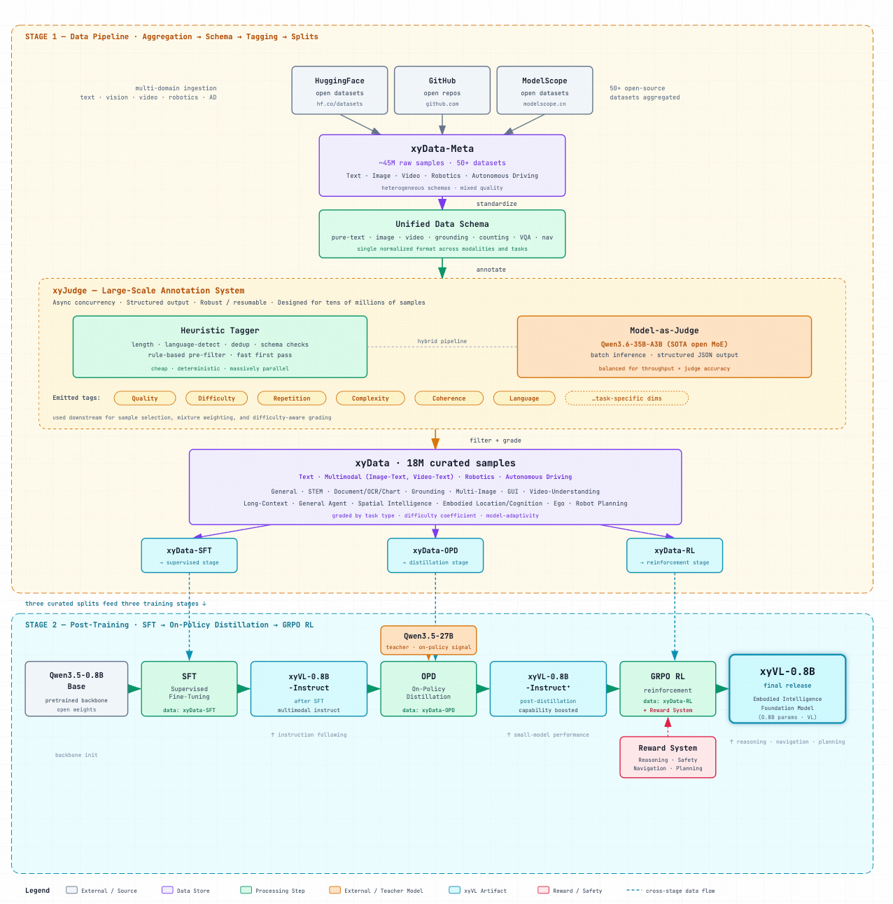
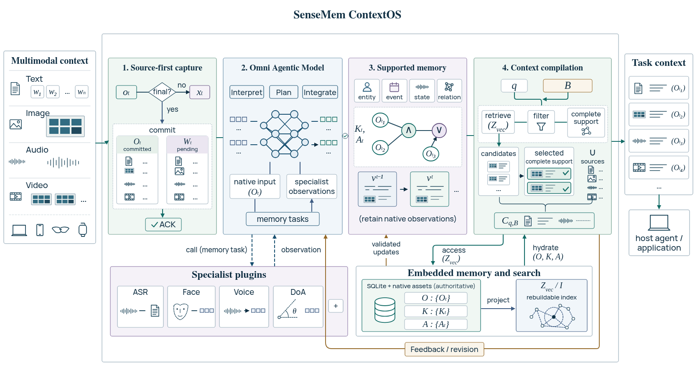
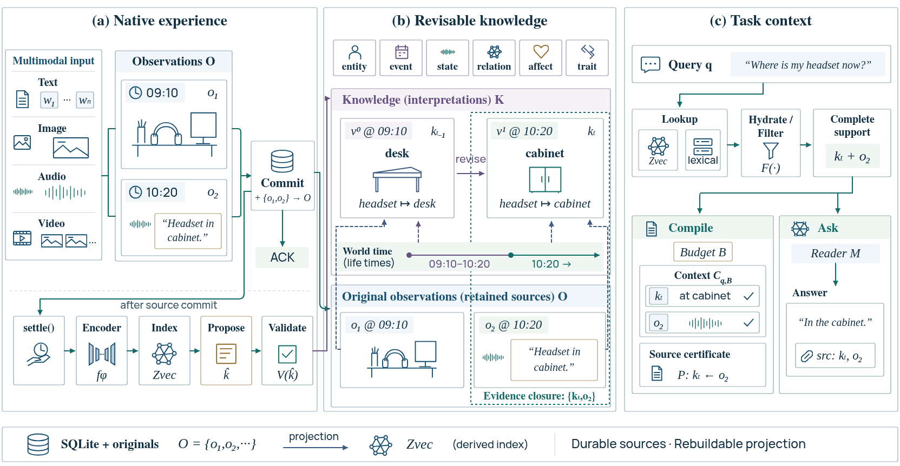
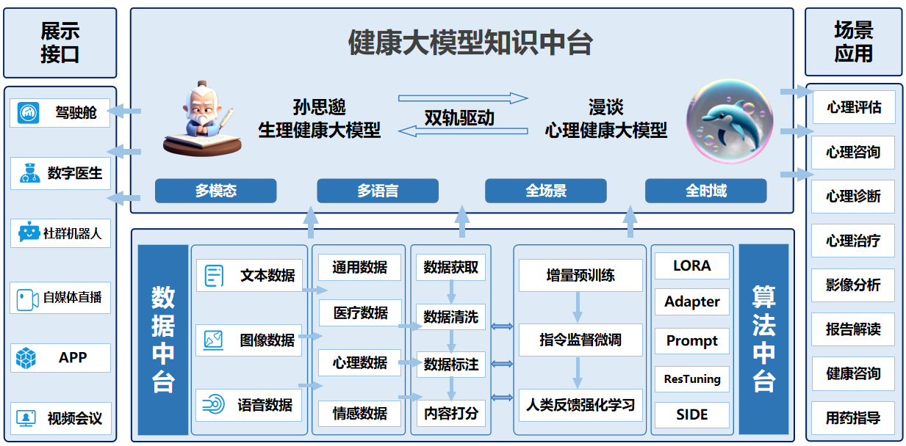
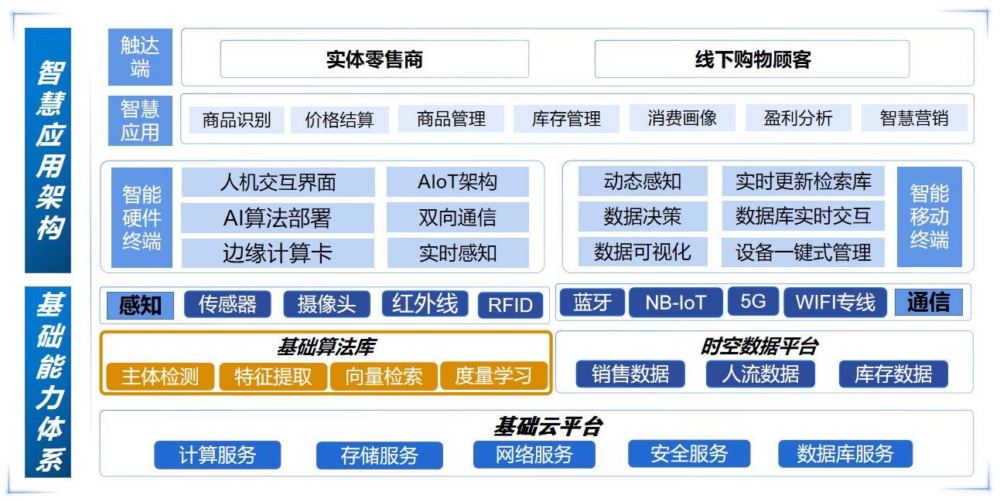








# About Me

我是**颜鑫（Xin Yan）**，专注于**多模态模型、Agent 系统与具身智能**。现任**心言集团（测测）高级算法工程师**，负责**心言机器人算法架构**，主导 **xyVL 具身视觉语言模型系列**研发，此前主导 **Xinyuan 系列垂域大模型**研发。我毕业于**华东理工大学自动化专业**。

我擅长贯通**模型研发、系统架构与产品开发**，从数据治理、模型训练和评估，到产品设计、开发与部署，推动技术进入实际应用。我以场景需求组织研发，以评估和使用反馈驱动迭代，在模型能力、算力投入、推理延迟与长期维护成本之间作出技术判断。

我的长期方向是 **AI 与人的持续交互**：让系统理解语境、记住共同经历，并随新信息更新判断。目前，我正在构建 **SenseMem、FateBridge 和 QianYe**，分别推进 Agentic Multimodal Memory、传统术数与占星计算，以及家庭记忆与共同叙事。

文学塑造了我理解人的方式，也影响着我对情感智能和产品体验的判断。我通过**开源项目、课程、写作与[公开分享](#talks-media)**交流技术方法，让模型与系统研发中的经验成为更多人可以使用和延伸的成果。

# News

* *2026.05*：合著出版《LangChain 大模型应用开发：从入门到实践》，清华大学出版社，周涛、薛栋、**颜鑫** 编著。
* *2026.01*：MindChat 团队获得 2025 合成数据大赛 · 灵溪 AI for Mental Health 主题赛**一等奖** - [报道](https://www.shobserver.com/wx/detail.do?id=1047568)。
* *2025.09*：受邀担任 2025 年云栖大会「做 AI，Z 世代不一样！」分论坛 **Speaker**。
* *2025.07*：获得 2024 年中国国际大学生创新大赛**铜奖**。
* *2025.07*：接受**阿里云通义实验室**与**魔搭 ModelScope 社区**联合采访，分享情感智能、模型评估与文学对技术实践的影响 - [播客](https://www.xiaoyuzhoufm.com/episode/6878c7f5a9dec92500c5c93e)。

# Professional Experience

**心言集团（测测） | 高级算法工程师** 
*2026.01 - 至今*

xyVL

**[心言机器人：xyVL Embodied Vision-Language Models](/images/xinyan-robot-xyvl-pipeline.png)**

我负责**心言机器人**算法架构，主导 **xyVL 具身视觉语言模型系列**研发，构建贯穿 **Multimodal Data Curation、自动化质量评估与 Post-training** 的研发流程。

**xyData：Multimodal Data Curation。** 整合 Hugging Face、GitHub 与 ModelScope 等平台的 **50+ 个开源数据集、约 4500 万条原始样本**，覆盖文本、图像、视频、机器人与自动驾驶。通过 Schema 统一、质量筛选与难度分级，构建 **1800 万条精选样本**；按任务分布、难度和模型适配性设计 Data Mixture，为 SFT、Distillation 与 Reinforcement Learning 分别组织训练数据。

**xyJudge：Model-as-a-Judge 质量评估与自动标注。** 将启发式规则与模型裁判结合，先检查样本长度、语言、重复与 Schema 合规性，再由 **Qwen3.6-35B-A3B** 输出质量、难度、重复度、复杂度与连贯性等结构化标签。通过异步并发与断点恢复，支撑千万级样本的评估与标注。

**Multimodal Post-training：SFT → On-Policy Distillation（OPD）→ GRPO。** 以 **Qwen3.5** 为基座构建多模态后训练流程：先进行指令微调，再以 **Qwen3.5-27B** 为教师模型开展 On-Policy Distillation，最后围绕推理、安全、导航与规划设计奖励并进行 GRPO 训练，优化环境理解与具身任务能力。

**心言集团（测测） | 高级算法工程师** 
*2024.03 - 2026.01*

我主导 **Xinyuan 系列垂域大模型**的全流程研发，覆盖多源多模态数据治理、增量预训练、SFT、RLHF 与多维评估；统筹 **5–20 人**的算法与工程团队，推进模型训练与部署，并组织部分模型开源。系列模型在 Hugging Face、ModelScope 等平台累计下载 **2 万+**。

面向心理、教育与陪伴场景，我将**对话连续性、情感表达、知识依据与领域适配**作为训练和评估重点，通过失败样本与用户反馈定位改进方向。在基座选型、模型规模与部署方案上，兼顾领域表现、通用能力、推理延迟、生态支持与维护成本，推动模型研发与产品需求衔接。

代表性工作：

* [Xinyuan-LLM-14B-0428](https://huggingface.co/Cylingo/Xinyuan-LLM-14B-0428)：基于 Qwen3-14B-Base，面向心理支持与教育等领域训练，公开模型权重与部署说明。
* [Xinyuan-VL-2B](https://huggingface.co/Cylingo/Xinyuan-VL-2B)：基于 Qwen2-VL-2B-Instruct，使用 **500 万+ 多模态样本**训练，2024 年 9 月在 OpenCompass & Hugging Face Open VLM Leaderboard 的 **<4B 参数组排名第一**。相关成果见[魔搭开发者共创会记录](https://developer.aliyun.com/article/1664742)。
* 在**魔搭 ModelScope 开发者共创会**分享《开源技术驱动下的泛心理服务与 AI 普惠实践之路》，并参与[通义实验室 × 魔搭社区专访](https://mp.weixin.qq.com/s/a16sWs_QPtvoeY4J5eexTg)，讨论模型选型、评估、个性化与端侧部署的取舍。

# Selected Projects

<figure class="project-figure">
  
  <figcaption>ContextOS Overview<a href="https://github.com/SenseMem/SenseMem/blob/master/docs/context-os.md" aria-label="SenseMem 技术报告，Figure 1">Fig. 1 ↗</a></figcaption>
</figure>
<figure class="project-figure">
  
  <figcaption>Memory Lifecycle<a href="https://github.com/SenseMem/SenseMem/blob/master/README.md" aria-label="SenseMem 技术报告，Figure 2">Fig. 2 ↗</a></figcaption>
</figure>

**[SenseMem：Agentic Multimodal Memory](https://github.com/SenseMem/SenseMem)**

**设计目标与追求。** 我发起 SenseMem，为 **Agentic Harness、个人助手与具身交互**构建统一的 **Omni-modal Memory & Context Layer**，让 Agent 理解持续交互中的语境、积累共同经历，并将长期记忆转化为当前任务所需的上下文。项目以 **3S** 为设计追求：**Smarter**，通过记忆形成、修正与召回提供更有用的上下文；**Swifter**，让能力组合、模型选择与系统接入更敏捷；**Stronger**，适配多样部署环境，追求跨模态、跨任务的领先表现。

我主导 **Memory Kernel** 的设计与实现，将文本、图像、音频、视频及其有序组合纳入统一内容契约，贯通原始观察、知识更新与任务上下文。内核统一管理证据、身份、时空与版本，按需接入模型完成 Memory Formation，并以可审计、可回滚的操作支持 Consolidation、Correction、Reinforcement 与可逆 Forgetting。**Hybrid Retrieval** 融合 Dense Retrieval、Lexical Search、时空与人物约束及可选 Semantic Reranking，**Context Compiler** 按条目、字符与媒体预算编排记忆和支撑证据，呈现冲突与信息缺口，并为 Grounded Answering 提供引用依据。底层以 SQLite 与原始媒体保存权威状态、Zvec 提供可重建索引，通过能力契约接入本地或远程的 Embedding、Generation、Speech、Vision 与记忆处理模型，SDK、REST、MCP 与 CLI 共享同一内核，衔接 Host Harness 的目标管理、调度与行动执行。

SenseMem 在 **MOSAIC、Mem-Gallery、ATM-Bench、LoCoMo-Refined** 等记忆 Benchmarks 上取得 **SOTA**：**MOSAIC** 面向文本、图像、音频与视频的全模态记忆，**Mem-Gallery** 面向视觉个性化记忆与图像关联对话，**ATM-Bench** 面向邮件、图像与视频等异构个人档案的检索与推理，**LoCoMo-Refined** 面向多会话长期对话记忆。这些成绩共同展现了 SenseMem 从全模态交互、个人媒体到长期对话的**跨场景通用性与领先表现**。

**[FateBridge：面向 Agentic Harness 的传统术数与占星计算引擎](https://github.com/thomas-yanxin/FateBridge)**

我发起并开发 FateBridge，为 **Agentic Harness** 构建本地 **Domain Computation Engine**，将传统术数与占星规则转化为可调用、可核对的领域工具，支持 Agent 从问题理解、计算调用到结果解释的完整流程。

项目集成八字、紫微、星盘等 **92 个 MCP 工具**，并提供 CLI 与 REST API。通过统一 Tool Catalog、Schema 校验与共享执行层，复用领域 Service 和计算内核，以结构化结果、时间口径与 Run Metadata 支撑结果溯源和按预算交付。

我将**历法与节气边界、时区与真太阳时、规则来源及流派差异**纳入核心工程设计，通过算法回归、独立参考与跨接口校验检查计算实现。系统记录输入条件与验证范围，区分计算输出、传统解释和现实建议，为 Agent 提供有来源、可追溯的解释依据。

**QianYe（亲百问）：家庭记忆与共同叙事**

我主导了亲百问的**产品设计与微信小程序研发**，围绕 **Family Memory & Collaborative Storytelling** 打造公益数字产品。以照片、物件与声音打开话题，将家庭成员的异步讲述组织为可共同核对和阅读的记忆手帐。

采用原生微信小程序、CloudBase 云函数与共享业务模块，围绕“讲述、核对、入册”串联录音、ASR 转写与可选 LLM 润色。异步任务衔接转写和内容整理，分段保存与草稿恢复支持随时继续讲述，大字与清晰的操作状态方便长辈使用。

产品以讲述者为中心，保留原声、原图与原始转写，支持原文直接入册或由本人选择、核对 AI 润色。家庭空间与邀请机制管理阅读和参与权限，让故事的表达方式与分享范围由讲述者和家人共同决定。

Health LLM Platform

**[健康大模型知识中台：MindChat 与 Sunsimiao](https://github.com/X-D-Lab)**

MindChat 起于我和老师关于家人陪伴的一次讨论，逐步发展为面向心理对话与医疗知识的 **Domain-specific LLM** 项目。我负责**模型训练**，并与团队协作完成数据构建、模型评估和应用集成。

围绕领域语料清洗、Domain Adaptation 与 Instruction Tuning 开展模型研发，并探索 Retrieval、Memory 与 Context Management 在多轮对话中的应用。我将对话连续性、知识依据和能力边界纳入评估，连接领域训练与真实对话需求。

团队开源了 [MindChat](https://github.com/X-D-Lab/MindChat) 与 [Sunsimiao](https://github.com/X-D-Lab/Sunsimiao) 的模型、推理示例和部署材料。这段实践积累了领域训练、对话评估与应用集成经验，也为我后续设计 Agentic Memory 系统奠定了基础。

ColugoMum

**[袋鼯麻麻 ColugoMum：智能零售结算平台](https://github.com/thomas-yanxin/ColugoMum)**

我负责 ColugoMum 的**项目管理、算法适配与端侧前端开发**，基于 **Image Retrieval** 构建智能零售结算平台，解决商品识别、相似包装区分与商品库持续更新中的工程问题。

基于 **PaddleClas / PP-ShiTu** 完成数据构建、轻量化模型调优与云边端集成，通过检索库增量更新接入新类别，减少重复训练需求，并针对小样本、相似包装与端侧推理延迟优化应用方案。

项目获得 **2022 年第 24 届中国机器人及人工智能大赛全国一等奖**，亮相 **Baidu Wave Summit 2021+**，并形成[论文](https://ieeexplore.ieee.org/document/9851085)、开源代码与教学实践。相关方法与实验见[技术文章](https://developer.cloud.tencent.com/article/2146677)。

**[欧小鹏 OXiaoPeng：从社群需求出发的模型应用](https://github.com/thomas-yanxin/OXiaoPeng)**

欧小鹏是面向微信社群的 **Conversational AI Application**，从广告处理、新成员欢迎与常见问题问答起步，逐步接入 ERNIE、PanGu、Yuan、ChatYuan 与 ChatGPT，将对话与 Text-to-Image 服务带入日常社群。项目需求与名称均来自社群共创。

我负责**模型 API 集成、功能迭代与服务维护**，将用户反馈转化为产品改进。针对上游接口变更引起的文生图服务中断，处理依赖适配与服务恢复，积累了面向真实用户持续运营 AI 应用的经验。

项目早期服务多个 AI 开源社群，累计直接用户 **2000+**、间接覆盖 **2 万+**，获得 **2022 年启智社区优秀孵化项目奖**，并入围 **2023 年奇绩春季创业营（S23）面试**。[《2022，我与启智》](https://www.cnblogs.com/thomas-yanxin/p/17067454.html)记录了项目的成长与社区的参与。

# Publications & IP

* 周涛、薛栋、**颜鑫**. 《LangChain 大模型应用开发：从入门到实践》[M]. 清华大学出版社, 2026.
* D. Xue, J. Tu, M. Wang, **X. Yan**, F. Liu and J. Hu, "[Towards Privacy-Preserving Mental Health Support with Large Language Models](https://arxiv.org/abs/2601.01993)," *arXiv preprint* arXiv:2601.01993, 2026.
* F.-Q. Cui, J. Huang, S. Zhao, J.-M. Guo, Q. Cai, **X. Yan** and Z. Liu, "[ReMA: A Training-Free Plug-and-Play Mixing Augmentation for Video Behavior Recognition](https://arxiv.org/abs/2601.00311)," *arXiv preprint* arXiv:2601.00311, 2026.
* F.-Q. Cui, J. Huang, S. Zhao, X. Li, **X. Yan**, Z. Jia and X. Zhou, "[Robust Low-Rank Sparse Framework for Video-Based Affective Computing](https://arxiv.org/abs/2511.11406)," *arXiv preprint* arXiv:2511.11406, 2025（2026 年修订）.
* **X. Yan**, Q. Hu, X. Huang and C. Shen, "[Intelligent Retail Settlement Platform based on Image Retrieval](https://ieeexplore.ieee.org/document/9851085)," 2022 4th International Conference on Communications, Information System and Computer Engineering (CISCE), 2022, pp. 609-616, doi: 10.1109/CISCE55963.2022.9851085. [全文](/proof/Intelligent_Retail_Settlement_Platform_based_on_Image_Retrieval.pdf)
* 【[实用新型专利](/proof/%E4%B8%93%E5%88%A9-2022208288888%E6%99%BA%E8%83%BD%E9%9B%B6%E5%94%AE%E7%BB%93%E7%AE%97%E5%B9%B3%E5%8F%B0.pdf)】智能零售结算平台；发明人：**颜鑫**、沈晨、杜旭东；专利号：ZL 2022 2 0828888.8；授权公告号：CN 216979871 U。
* 【[软件著作权](/proof/%E8%BD%AF%E4%BB%B6%E8%91%97%E4%BD%9C%E6%9D%83-%E8%A2%8B%E9%BC%AF%E9%BA%BB%E9%BA%BB.jpg)】袋鼯麻麻：智能零售结算系统 V1.0；著作权人：**颜鑫**、胡庆春、沈晨、杜旭东、黄小悦、申佳川；登记号：2022SRE010935。
* 【[软件著作权](/proof/%E8%BD%AF%E4%BB%B6%E8%91%97%E4%BD%9C%E6%9D%83-%E6%85%A7%E7%9C%BC%E8%AF%86%E5%9E%83%E5%9C%BE.jpg)】慧眼识垃圾系统 V1.0；著作权人：**颜鑫**、沈晨、杜旭东；登记号：2021SR0986633。
* 【[软件著作权](/proof/%E8%BD%AF%E4%BB%B6%E8%91%97%E4%BD%9C%E6%9D%83-%E8%87%AA%E5%8A%A8%E9%97%AE%E7%AD%94.pdf)】基于领域知识库的智能问答系统 V1.0；著作权人：黄小悦、韩响尘、王鑫、**颜鑫**、林宏聪、任竞展、周天奕；登记号：2022SRE025369。

# Talks & Media

我受邀在技术大会、开发者社区与课程中分享**模型选型、评估与应用开发**经验，并通过公开访谈讨论文学、情感智能与产品设计如何影响技术实践。

## Invited Talks

* *2025.09*：2025 年云栖大会「做 AI，Z 世代不一样！」分论坛，Speaker。
* *2025.05*：阿里云魔搭 ModelScope 开发者共创会，《开源技术驱动下的泛心理服务与 AI 普惠实践之路》。
* *2023.06*：飞桨 PaddlePaddle 大模型应用开发课，《全流程构建智能文档查询助手》 - [视频](https://www.bilibili.com/video/BV18h4y1d77H/)
* *2023.05*：Datawhale AIGC 主题学习，《基于 LangChain 和 ChatGLM-6B 构建本地知识库自动问答应用》 - [视频](https://www.bilibili.com/video/BV11N411y7dT/)
* *2022.04*：飞桨产业实践范例库，商品识别产业应用实战 - [视频](https://www.bilibili.com/video/BV1Fu411y7co/)

## Media Coverage

* **通义实验室 × 魔搭社区｜写代码，也写情绪** - [文章](https://mp.weixin.qq.com/s/a16sWs_QPtvoeY4J5eexTg) / [短视频](https://www.bilibili.com/video/BV1GVgNzLEHs/) / [完整播客 · 47:52](https://www.xiaoyuzhoufm.com/episode/6878c7f5a9dec92500c5c93e) 
  谈情感智能的研究动机、文学对理解人的影响，以及评估如何指导模型改进。
* **Founder Park｜Qwen 3 与垂域模型实践** - [原文](https://mp.weixin.qq.com/s/pb8eoQhvAF9O5N3CSO7rIg) / [采访实录转载](https://news.sina.com.cn/sx/2025-04-30/detail-ineuxrwv4808216.shtml) 
  从语音转写丢失的情感线索谈起，讨论后训练中领域与通用能力的平衡，以及成本、生态和产品流程对技术选择的影响。
* **科学网 / 中国科学报｜人皆孤独？他们用通义千问开发了一款心理大模型** - [原文](https://news.sciencenet.cn/htmlnews/2023/12/513458.shtm) 
  回顾 MindChat 从家人陪伴的讨论走向模型实践的过程，以及早期对模型持续迭代、生态与场景适配的考虑。

更多报道与公开内容

* 【阿里通义千问】通义千问 + 心理领域 = ? - [链接](https://mp.weixin.qq.com/s/ZcRES0s7zD_yDeWTTr6Gyg)
* 【机器之心 SOTA 模型】MindChat 心理大模型等项目多个新模型版本开源 - [链接](https://mp.weixin.qq.com/s/PppVdSHObBG7IRA-vgVLlA)
* 【机器之心 SOTA 模型】不妨一试的开源项目：基座模型、领域精调、推理加速及 Agent 开发开源方案季度盘点 - [链接](https://mp.weixin.qq.com/s/ApOMU6qRfYopCW0NkUCQCQ)
* 【OpenMMLab】EMO 了？来和 MindChat 聊聊，可在线体验的 AI 心理大模型 - [链接](https://mp.weixin.qq.com/s/wOQP2A0nm0OGaiwzdJ9wPg)
* 【魔搭 ModelScope 社区】基于 Qwen-7B 的垂域大模型 MindChat 心理大模型上线魔搭 - [链接](https://mp.weixin.qq.com/s/frJwp-kLuF_aT_vt8V6hJQ)
* 【GitHubStore】MindChat 心理大模型 - [链接](https://mp.weixin.qq.com/s/OIHSBq6c-4QAxvDUqmgpFA)
* 【OpenI 启智】2022 年度启智社区优秀项目及开发者评选结果正式揭晓 - [链接](https://mp.weixin.qq.com/s/PpbwEdP0-8wG9dsvRvRDaA)
* 【OpenI 启智】高校开源专场顺利举办 - [链接](https://mp.weixin.qq.com/s/phDFWZ8YOYEJMoYNrsOrag)
* 【飞桨 PaddlePaddle】飞桨助力合肥工业大学普适心理计算团队斩获“互联网+”大赛全国银奖 - [链接](https://mp.weixin.qq.com/s/SgK9qSmYQ9ihIfvb1sHEwA)
* 【组队学习】我们做了一个智能零售结算平台 - [链接](https://mp.weixin.qq.com/s/Ons9jLOekpbTPfcjW87Q3Q)
* 【OpenI 启智】连续 4 周上榜的这位开发者 - [链接](https://mp.weixin.qq.com/s/vgsMagmEVbcsXBVqil9_5A)
* 【Datawhale】我们做了一个智能零售结算平台 - [链接](https://mp.weixin.qq.com/s/V8eBkYZvb-mNJtyez7n_Rg)
* 【OpenI 启智】OpenI 开源项目推荐 ColugoMum - [链接](https://mp.weixin.qq.com/s/mgNcoWAICBAqkPCqqBN8Iw)
* 【飞桨 PaddlePaddle】欢迎 17 名 AI 开发者加入飞桨开发者技术专家计划 - [链接](https://mp.weixin.qq.com/s/PAeREjahNTSJmwn1QtI3Zg)
* 【太原理工大学互联网 PLUS 提升平台】百度飞桨校园 Fest 圆满结束 - [链接](https://mp.weixin.qq.com/s/-VoCDzr1MjeGm4UQuRxORw)
* 【安徽工程大学计算机学院团委】首届 AI 科创节圆满结束 - [链接](https://mp.weixin.qq.com/s/oCVRHA5Hg41PqTQ-yJQgkg)
* 【飞桨 PaddlePaddle】基于飞桨开发垃圾分类小程序，实现“慧眼识垃圾” - [链接](https://mp.weixin.qq.com/s/6xt4ReF-n4qyJ859yvCbcg)
* 【机器学习 AI 算法工程】垃圾分类：慧眼识垃圾系统 - [链接](https://mp.weixin.qq.com/s/rsJSLKaNxtJ06HnwbWbL-w)
* *2021.07*：飞桨领航团 AI 达人创造营（课程系列合集） - [视频](https://www.bilibili.com/video/BV1qq4y1X7uZ/)
* *2021.05*：飞桨开发者说，《慧眼识垃圾》 - [视频](https://www.bilibili.com/video/BV13p4y1t76K/)

# Community & Activities

我持续参与**开源项目、技术教学与开发者社区建设**，将研发经验转化为可实践的课程和项目。通过高校活动、社区协作与长期维护，连接开发者、使用者和新的合作机会。

**[飞桨领航团](https://www.paddlepaddle.org.cn/ppdenavigategroup) | 华东区主管** 
*2021.09 - 2022.07*

* 统筹飞桨领航团**华东七省**运营，负责高校拓展、团长选拔、活动策划与项目推进。任期内新增覆盖 **50+ 所高校**，包括浙江大学、东南大学、上海科技大学、南京航空航天大学、苏州大学、华东理工大学与合肥工业大学等。

**[华东理工大学飞桨领航团](https://www.paddlepaddle.org.cn/ppdenavigategroup) | 团长** 
*2021.04 - 2022.01*

* 从零组建校级飞桨领航团，组织主题讲座、知识竞赛、实操挑战赛与项目体验，累计举办 **5+ 场活动**、覆盖 **100+ 人次**、孵化 **10+ 个项目**。
* 推进“教育部产学合作协同育人项目（百度公司 & 华东理工大学）”课程建设，将社区实践整理为面向校内 AI 人才培养的课程资源。

更多社区与社会实践

* 2022 OpenI 启智社区首批资深体验官
* 2022 OpenI 启智社区 & 合肥工业大学情感计算与先进智能机器安徽省重点实验室产学研共建学生负责人 - [证明](/proof/OpenI&MAC_LAB.jpg)
* 2022 百度飞桨智慧零售商品识别产业案例共建者 - [视频](https://www.bilibili.com/video/BV1Fu411y7co/)
* 2022 华东理工大学通海茶叙第 130 期讲座嘉宾 - [证明](https://mp.weixin.qq.com/s/yyOjg0qnRo8TggylMhyqgA)
* 2022 Datawhale 组队学习第 34 期航海士 - [证明](https://mp.weixin.qq.com/s/8NAmTy5n7TXxVH85WAR-gA)
* 2022 百度飞桨领航团 AI 达人创造营第二期讲师 - [证明](https://mp.weixin.qq.com/s/JfHYZZE701Qt7vJJa1K11w)
* 2021 百度飞桨领航团 AI 达人创造营第一期讲师 - [证明](https://mp.weixin.qq.com/s/MD-ni4z5EITpdrAZd2FGyg)
* 2021 百度上海飞桨领航团 & 五角场创新创业学院 meetup 活动 - [证明](https://mp.weixin.qq.com/s/NMJVAttPUHiZEaIIz1zQoA)

# Awards & Honors

## Featured Awards

* 2025 合成数据大赛 · 灵溪 AI for Mental Health 主题赛**一等奖（MindChat 团队）** - [报道](https://www.shobserver.com/wx/detail.do?id=1047568)
* 2024 中国国际大学生创新大赛「人因智能关键技术——非接触集成式驾驶员状态智能检测边缘计算技术」**铜奖**
* 2023 第 9 届中国国际“互联网+”大学生创新创业大赛「灵心智能」**铜奖**
* 2022 第 8 届中国国际“互联网+”大学生创新创业大赛「晓声科技」**银奖** - [证明](https://mp.weixin.qq.com/s/EujzF8ubT_1PkoMs3u-qTw)
* 2022 第 24 届中国机器人及人工智能大赛全国**一等奖** - [证明](https://github.com/thomas-yanxin/thomas-yanxin.github.io/blob/master/proof/2022%E5%B9%B4%E7%AC%AC24%E5%B1%8A%E4%B8%AD%E5%9B%BD%E6%9C%BA%E5%99%A8%E4%BA%BA%E5%8F%8A%E4%BA%BA%E5%B7%A5%E6%99%BA%E8%83%BD%E5%A4%A7%E8%B5%9B%E5%85%A8%E5%9B%BD%E4%B8%80%E7%AD%89%E5%A5%96.pdf)

## Selected Honors

* 百度飞桨开发者技术专家 - [证明](https://www.paddlepaddle.org.cn/ppdemd?n=/ppdemd/%E9%A2%9C%E9%91%AB)
* 开放原子开源基金会**活力开源贡献者（技术、生态贡献）**
* 百度飞桨 AIStudio 2022 年度影响力人物 **TOP10** - [证明](https://mp.weixin.qq.com/s/jKTEAP1euh4yBoatod9E0Q)
* OpenI 启智社区首批核心体验官
* Datawhale 成员 - [证明](https://mp.weixin.qq.com/s/_I-aNX1lAPV2_eYoS0w_Bg)
* Qwen Ambassador

更多竞赛与荣誉

* 2024 安徽省大学生创新创业大赛「AI 赋能下的军民融合应用创新」产业赛道**金奖**
* 2023 第 9 届安徽省“互联网+”大学生创新创业大赛「灵心智能」**金奖**
* 2022 “建行杯”第 8 届安徽省“互联网+”大学生创新创业大赛「晓声科技」**金奖** - [证明](https://github.com/thomas-yanxin/thomas-yanxin.github.io/blob/master/proof/%E3%80%90%E6%99%93%E5%A3%B0%E7%A7%91%E6%8A%80%E3%80%91%E5%AE%89%E5%BE%BD%E7%9C%81%E9%87%91%E5%A5%96.pdf)
* 2022 “建行杯”第 8 届江苏省“互联网+”大学生创新创业大赛「镜选未来」**银奖** - [证明](https://github.com/thomas-yanxin/thomas-yanxin.github.io/blob/master/proof/%E7%AC%AC%E5%85%AB%E5%B1%8A%E6%B1%9F%E8%8B%8F%E7%9C%81%E2%80%9C%E4%BA%92%E8%81%94%E7%BD%91%2B%E2%80%9D%E5%A4%A7%E5%AD%A6%E7%94%9F%E5%88%9B%E6%96%B0%E5%88%9B%E4%B8%9A%E5%A4%A7%E8%B5%9B_%E8%B7%AF%E6%BC%94%E9%A1%B9%E7%9B%AE%E8%AF%84%E5%AE%A1%E7%BB%93%E6%9E%9C%E5%8F%91%E5%B8%83%E7%89%88%E6%9C%AC%20.pdf)
* 2022 “建行杯”第 8 届上海市“互联网+”大学生创新创业大赛「Medbio」**银奖** - [证明](https://github.com/thomas-yanxin/thomas-yanxin.github.io/blob/master/proof/Medbio-%E6%B4%BB%E6%80%A7%E5%B0%8F%E5%88%86%E5%AD%90%E5%8C%96%E5%90%88%E7%89%A9%E7%A7%91%E7%A0%94%E6%9C%8D%E5%8A%A1%E5%B9%B3%E5%8F%B0.pdf)
* 2022 第 7 届“创客中国”百度赛道创客组「镜选未来」**优胜奖（Top10）** - [证明](https://mp.weixin.qq.com/s/kAp6jfZpvG2eolcWSANHSQ)
* 2022 第 13 届“挑战杯”大学生创业计划竞赛上海市「袋鼯麻麻」**铜奖** - [证明](https://github.com/thomas-yanxin/thomas-yanxin.github.io/blob/master/proof/2022%E5%B9%B4%E6%8C%91%E6%88%98%E6%9D%AF%E5%B8%82%E7%BA%A7%E5%A4%8D%E8%B5%9B%E7%BB%93%E6%9E%9C-%E5%8D%8E%E4%B8%9C%E7%90%86%E5%B7%A5%E5%A4%A7%E5%AD%A6.pdf)
* 2022 第 10 届华东理工大学“奋进杯”大学生创业计划竞赛「袋鼯麻麻」**金奖** - [证明](https://mp.weixin.qq.com/s/WgE9zxD4Nv4H-f_2sXr5pw)
* 2022 第 8 届南京财经大学“互联网+”大学生创业计划大赛「数聚凤巢」**一等奖**
* 2022 第 8 届华东理工大学“互联网+”大学生创业计划大赛「袋鼯麻麻」**一等奖**
* 2022 第 1 届合肥工业大学“智能杯”创新创业大赛「晓声科技」**二等奖** - [证明](/proof/首届合肥工业大学”智能杯“创新创业大赛大创组二等奖.jpg)
* 2022 第 15 届中国大学生计算机设计大赛（程序设计组）全国**三等奖** - [证明](https://github.com/thomas-yanxin/thomas-yanxin.github.io/blob/master/proof/2022%E5%B9%B4%EF%BC%88%E7%AC%AC15%E5%B1%8A%EF%BC%89%E4%B8%AD%E5%9B%BD%E5%A4%A7%E5%AD%A6%E7%94%9F%E8%AE%A1%E7%AE%97%E6%9C%BA%E8%AE%BE%E8%AE%A1%E5%A4%A7%E8%B5%9B%E4%B8%89%E7%AD%89%E5%A5%96.pdf)
* 2022 第 15 届中国大学生计算机设计大赛（物联网组）全国**三等奖** - [证明](https://github.com/thomas-yanxin/thomas-yanxin.github.io/blob/master/proof/2022%E5%B9%B4%E7%AC%AC15%E5%B1%8A%E4%B8%AD%E5%9B%BD%E5%A4%A7%E5%AD%A6%E7%94%9F%E8%AE%A1%E7%AE%97%E6%9C%BA%E8%AE%BE%E8%AE%A1%E5%A4%A7%E8%B5%9B%EF%BC%88%E7%89%A9%E8%81%94%E7%BD%91%E7%BB%84%EF%BC%89%E5%85%A8%E5%9B%BD%E4%B8%89%E7%AD%89%E5%A5%96.jpg)
* 2022 第 24 届中国机器人及人工智能大赛（上海赛区）人工智能创新赛**一等奖** - [证明](https://github.com/thomas-yanxin/thomas-yanxin.github.io/blob/master/proof/%E7%9B%96%E7%AB%A0%E5%85%AC%E7%A4%BA-%E4%B8%8A%E6%B5%B7%E8%B5%9B%E5%8C%BA%E6%8B%9F%E8%8E%B7%E5%A5%96%E5%90%8D%E5%8D%95%E5%85%AC%E7%A4%BA%E7%9A%84%E9%80%9A%E7%9F%A5.pdf)
* 2022 第 5 届中国高校计算机大赛（人工智能创意赛）区域赛（华东赛区）**二等奖**
* 2022 第 14 届上海市计算机应用能力设计大赛（程序设计组）**二等奖**
* 2022 第 14 届上海市计算机应用能力设计大赛（物联网组）**二等奖**
* 2022 OpenI 启智社区**社区先锋奖**、**优秀孵化项目奖** - [证明](https://mp.weixin.qq.com/s/rEXoEY1UbEgwolYE-OJPjw)
* 2022 OpenI 启智社区“优秀开源项目征集”**第一名** - [证明](/proof/%E8%A2%8B%E9%BC%AF%E9%BA%BB%E9%BA%BB.png)
* 2022 OpenI 启智社区“优秀开源项目征集”**第二名** - [证明](/proof/%E6%AC%A7%E5%B0%8F%E9%B9%8F.png)
* 2022 讯飞开放生态 AI 先锋应用评比**年度最佳应用 TOP10** - [证明](https://mp.weixin.qq.com/s/P6VaXjlXWLT0JGvBFRDIvQ)
* 2022 第 2 届“点宽杯”全国高校金融科技黑客松大赛**优胜队伍** - [证明](https://mp.weixin.qq.com/s/0nwc8CRLXZZaJnAg6JJjVA)
* 2021 第 23 届中国机器人及人工智能大赛（上海赛区）人工智能创新赛**二等奖**
* 2021 PPSIG **优秀开源项目奖** - [证明](/proof/PPSIG%E5%A5%96%E6%9D%AF.jpg)
* 2021 飞桨黑客马拉松**优秀开源项目奖** - [证明](/proof/%E9%A3%9E%E6%A1%A8%E9%BB%91%E5%AE%A2%E6%9D%BE.jpg)
* 2021 WAVE SUMMIT 2021+ **优秀开源项目** - [证明](/proof/WS%E4%BC%98%E7%A7%80%E5%BC%80%E6%BA%90%E9%A1%B9%E7%9B%AE.jpg)
* 2022 国家级大学生创新创业项目**第一主持人**，**优秀结题** - [证明](https://cxcy.ecust.edu.cn/2023/1206/c14247a163409/page.htm)
* 英特尔创新大使、华为云云享专家、中国人工智能学会会员、中国自动化学会预备会员、中国宇航学会会员。
* 2022 Jina 社区活跃贡献者、阿里云开发者社区乘风者计划专家博主、OpenI 启智社区积极贡献者、OpenI 启智社区活跃开发者。
* 百度飞桨 WAVE SUMMIT 2021 / 2021+ 优秀开源开发者。

# Education

**华东理工大学 | 信息科学与工程学院 | 自动化专业** 
*2019.09 - 2023.06*

# Contact

欢迎围绕**多模态模型、Agent 系统、记忆架构与具身智能**开展技术交流与合作。项目合作、公开分享或使用反馈，请联系 [yx20001210@gmail.com](mailto:yx20001210@gmail.com)。更多开源代码与近期工作见 [GitHub](https://github.com/thomas-yanxin)。
