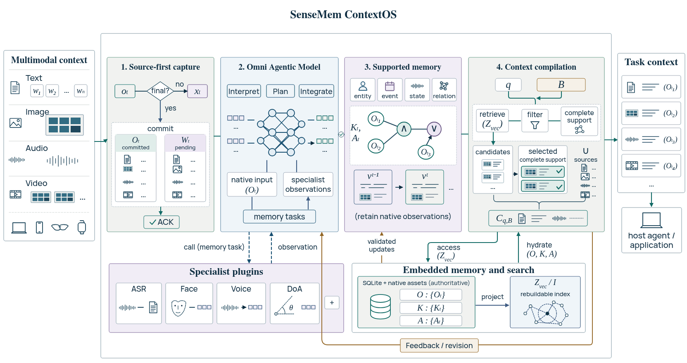
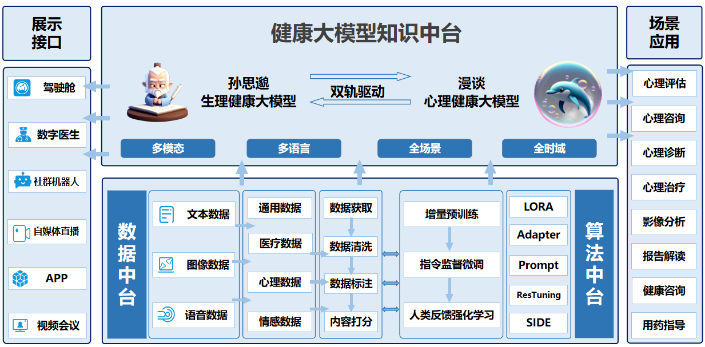
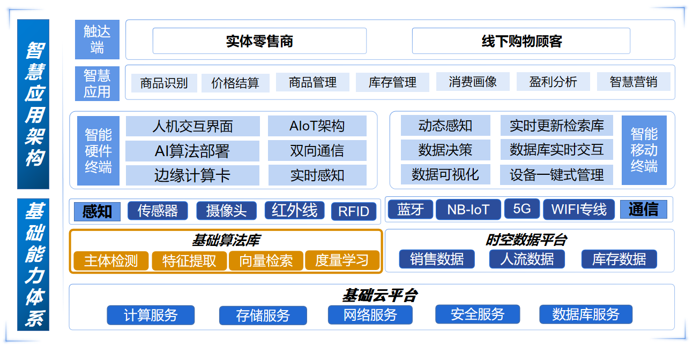

<section class="home-section home-section--about" aria-labelledby="about-me" markdown="1">



# 👋 About Me {#about-me}

我是**颜鑫（Xin Yan）**，创作者、开发者、研究者，本质上是一名**创业者**{: .key-accent}。我长期专注**持续人机交互与具身智能**，以**端到端 Co-design**{: .key-accent} 方法论，将**产品定义、多模态数据与 Rubrics、基座模型后训练、Agentic Harness 与系统评估**闭环打通，把前沿算法转化为可规模化交付的产品能力。
{: .intro-lead}

现任**心言机器人高级算法工程师**，负责**机器人算法架构**，主导 **xyVL 具身原生多模态基座模型**及配套的 **xyData** 与 **xyJudge** Rubrics 体系，并发起全模态记忆系统 **SenseMem**，在 MOSAIC 等四项权威记忆基准取得 **SOTA**{: .key-accent}。此前在**心言集团**带领 5–20 人团队主导 **Xinyuan 系列垂域与多模态大模型**研发，累计下载 **2 万+**，其中 **Xinyuan-VL-2B** 登顶 OpenCompass & Hugging Face Open VLM Leaderboard **<4B 参数组第一**{: .key-accent}。更早作为联合创始人创立 **X-D Lab**，开源 **MindChat** 与 **Sunsimiao**。毕业于**华东理工大学自动化专业**。

我的核心研究与工程主线聚焦于 **AI 与人的长期共生交互**：如何通过 **Data–Rubrics–Policy Co-design** 构建面向真实物理环境的具身多模态模型，如何借助 **Agentic Memory 与 Context Engineering** 让智能体在全模态交互中持续更新认知与编排上下文，以及如何通过全双工视听交互与情感智能让技术真正理解人。

我的 MBTI 是 **INTJ**。文学塑造了我理解人的颗粒度，也构成了我在情感智能与产品体验判断上的底层直觉。

作为 **[Datawhale Member](https://mp.weixin.qq.com/s/_I-aNX1lAPV2_eYoS0w_Bg)**、**Qwen Ambassador** 与 **北京大学信班企业导师**，我深度参与开源生态与技术教育。发起及参与的开源项目累计获得 **GitHub 30,000+ Stars**{: .key-accent}，合著清华大学出版社专著 1 部，在 **IEEE TIFS、TCE** 等期刊发表论文多篇，并持续通过**开源共建、课程写作与[公开演讲](#talks-media)**分享一线实践。

</section>

<section class="home-section home-section--news" aria-labelledby="news" markdown="1">

## 📰 News {#news}

* *2026.11* 📺 接受**浙江卫视**人物专访，分享 AI 具身与情感交互一线实践 \| 🎬 [视频](http://wap.cztv.com/tv/35/2991249.html)。
* *2026.08* 🔥 获 面壁智能 & OpenBMB 社区「**火种说**」深度专题报道，解析 **YRobot 全双工全模态桌面陪伴机器人**{: .key-accent}工程实践 \| 📄 [文章](https://mp.weixin.qq.com/s/8pZUlvvhBve3G9CBNt_Q3Q)。
* *2026.05* 📖 合著专著《LangChain 大模型应用开发：从入门到实践》由**清华大学出版社**{: .key-accent}正式出版（周涛、薛栋、**颜鑫** 编著）。
* *2026.01* 🏆 **MindChat** 团队斩获 2025 合成数据大赛 · 灵溪 AI for Mental Health 主题赛**一等奖**{: .key-accent} \| 📄 [文章](https://www.shobserver.com/wx/detail.do?id=1047568)。
* *2025.09* 🎤 受邀登台 2025 年云栖大会「做 AI，Z 世代不一样！」分论坛担任 **Speaker** \| 🎬 [视频](https://yunqi.aliyun.com/2025/session?agendaId=6012)。
* *2025.07* 🥉 荣获 2024 年中国国际大学生创新大赛**全国铜奖**。
* *2025.07* 🎧 接受 通义实验室 × 魔搭 ModelScope 联合深度专访，探讨情感智能、评估驱动迭代与文学对 AI 产品直觉的影响 \| 🎧 [播客](https://www.xiaoyuzhoufm.com/episode/6878c7f5a9dec92500c5c93e)。
{: .news-list role="list"}

</section>

<section class="home-section home-section--experience" aria-labelledby="professional-experience" markdown="1">

## 💼 Professional Experience {#professional-experience}

<header class="experience-heading">
<h3 class="brand-heading">心言机器人 | 高级算法工程师</h3>

2026.01 - 至今

</header>

<h4 class="project-title">🤖 <a href="/xyvl/">xyVL：具身原生多模态基座模型</a></h4>

<figure class="project-figure project-figure--portrait">
  <iframe class="xyvl-embed" src="/xyvl/?embed=1" title="xyData、xyJudge 与 xyVL 的协同设计动效" loading="lazy" width="560" height="440"></iframe>
</figure>

负责**心言机器人**核心算法架构，主导构建 **Data–Rubrics–Model Co-design**{: .key-accent} 具身研发闭环，统筹具身原生多模态基座模型 **xyVL**、全流程自动化多模态数据引擎 **xyData** 与统一具身 **Rubrics System：xyJudge**。三者围绕具身环境理解、空间推理、安全对齐、导航与规划深度协同：xyData 精确塑形训练分布，xyJudge 将质量标准与具身任务目标转化为可执行评价规约，xyVL 通过多阶段多模态后训练兑现物理世界任务能力。

**xyData｜全流程自动化多模态数据治理引擎。** 系统整合 Hugging Face、GitHub 与 ModelScope 等平台 **50+ 开源数据集、约 4500 万条原始样本**，横跨文本、图像、视频、机器人操作与自动驾驶。经自动化接入、Schema 统一、质量门控与难度分层，提炼 **1800 万条高信噪比精选样本**{: .key-accent}；并按任务分布、难度梯度与模型适配性设计分阶段 **Data Mixture**，定向驱动 SFT、Distillation 与 RL 训练。

**xyJudge｜统一具身 Rubrics System。** 将数据质量门控与具身任务规范抽象为结构化 **Rubrics**，融合确定性启发式规则与 **Model-as-a-Judge** 自动裁判。规则侧严格校验长度、语种、重复与 Schema 合规性；模型侧基于 **Qwen3.6-35B-A3B** 对质量、难度、冗余度、复杂度与连贯性进行多维结构化打标。借助异步高并发与断点续传机制，支撑**千万级样本**的高吞吐自动化评估与标注，为 xyData 筛选与后训练配比提供统一、可复现的评价基线。

**xyVL｜具身原生多模态基座模型。** 以 **Qwen3.5** 为基座，搭建 **SFT → On-Policy Distillation（OPD）→ GRPO**{: .key-accent} 三阶段多模态 **Post-Training** 管线：SFT 完成指令与具身任务对齐；OPD 引入 **Qwen3.5-27B** 作为教师模型，直接在学生自身生成的 On-Policy 轨迹上施加监督以消除分布偏移；GRPO 围绕推理、安全、导航与规划设计任务奖励。后训练全程与 xyData 配比策略、xyJudge 评价规约协同迭代，夯实具身环境感知与规划决策底座。

<h4 class="project-title"> <a href="https://github.com/SenseMem/SenseMem">SenseMem：Agentic Omni-modal ContextOS</a></h4>

发起并架构 **SenseMem**，打造面向长期交互的**全模态记忆与上下文操作系统（Agentic Omni-modal ContextOS）**{: .key-accent}，为 **Personal Agent、Agentic Harness 与具身交互系统**提供持久记忆与 **Context Engineering** 底座。系统将文本、图像、音频与视频中的持续交互经验转化为可演化、可溯源的动态记忆，围绕 **3S** 架构原则设计：**Smarter**（以全生命周期记忆形成、认知修正与精准召回编排任务上下文）、**Swifter**（可组合模型后端与多协议无缝接入）、**Stronger**（面向端云多样部署环境优化跨模态、跨任务泛化表现）。

<figure class="project-figure">
  
  <figcaption>ContextOS Overview<a href="https://github.com/SenseMem/SenseMem/blob/master/docs/context-os.md" aria-label="SenseMem 技术报告，Figure 1">Fig. 1 ↗</a></figcaption>
</figure>

主导 **Memory Kernel** 核心架构与实现，建立覆盖文本、图像、音频、视频及其有序组合的统一内容契约，坚持 **Source-first** 分层设计——严格分离不可变原始观察与派生知识。内核以身份、时空、证据链与版本血缘约束记忆演化，按需编排模型执行 Memory Formation，并通过可审计、可回滚的 **Consolidation、Correction、Reinforcement 与可逆 Forgetting** 机制随新观察持续自我更新。

<figure class="project-figure">
  
  <figcaption>Memory Lifecycle<a href="https://github.com/SenseMem/SenseMem/blob/master/README.md" aria-label="SenseMem 技术报告，Figure 2">Fig. 2 ↗</a></figcaption>
</figure>

**Hybrid Retrieval** 深度融合 Dense Retrieval、Lexical Search、时空与人物实体约束及可选 Semantic Reranking，精准召回任务关联记忆。**Context Compiler** 在严格的条目、字符与媒体预算内动态编排记忆、原始媒体与证据闭包，并显式标示认知冲突与信息缺口，为 Host Agent 的可靠推理与有据回答提供高密度上下文。

底层由 **SQLite 与原生媒体**保障权威状态持久化，配合可随时重建的 **Zvec** 索引；通过强类型契约解耦本地与远程 Embedding、生成、语音、视觉及记忆处理模型，并经由共享内核的 **SDK、REST、MCP 与 CLI** 统一接口与宿主 Agentic Harness 的目标、调度及动作闭环对接。

截至 2026 年 11 月，SenseMem 在 **MOSAIC、Mem-Gallery、ATM-Bench、LoCoMo-Refined** 四项权威记忆基准上全面取得 **SOTA**{: .key-accent}：覆盖全模态跨会话记忆（**MOSAIC**）、视觉个性化记忆与图像关联对话（**Mem-Gallery**）、邮件、图像与视频等异构个人档案检索推理（**ATM-Bench**）以及多会话长期对话记忆（**LoCoMo-Refined**），系统验证了其在全模态交互、个人媒体与长程对话场景下的领先实力。

<header class="experience-heading">
<h3 class="brand-heading">心言集团（测测） | 高级算法工程师</h3>

2024.03 - 2026.01

</header>

主导 **Xinyuan 系列垂域与多模态大模型**从 0 到 1 研发与交付，统筹 **5–20 人**算法与工程团队，将**领域适配、交互对齐与端云部署约束**纳入统一工程闭环，完整覆盖多源多模态数据治理、**增量预训练、Mid-Training、SFT 与 RLHF 偏好对齐**、多维评测与生产部署。系列开源模型在 Hugging Face 与 ModelScope 累计下载 **2 万+**{: .key-accent}。

面向心理支持、教育与陪伴场景，推行 **Eval-Driven 迭代范式**：将**多轮对话连续性、共情表达颗粒度、专业知识依据与领域安全**转化为可量化训练与评价维度，依托失败样本归因与真实用户反馈持续闭环优化；在基座选型与参数规模决策上，系统权衡领域效果、通用能力保持、推理延迟、部署生态与维护成本，确保模型能力与业务交付条件高度对齐。

代表性成果：

* [Xinyuan-VL-2B](https://huggingface.co/Cylingo/Xinyuan-VL-2B)：面向端侧视觉理解场景，基于 Qwen2-VL-2B-Instruct 以 **500 万+ 多模态样本**开展 Vision-Language Post-Training，2024 年 9 月登顶 OpenCompass & Hugging Face Open VLM Leaderboard **<4B 参数组第一**{: .key-accent}。相关成果见[魔搭开发者共创会记录](https://developer.aliyun.com/article/1664742)。
* [Xinyuan-LLM-14B-0428](https://huggingface.co/Cylingo/Xinyuan-LLM-14B-0428)：基于 Qwen3-14B-Base，融合 **100K+ 心理对话与 1M+ 医疗语料**完成领域适配与后训练，开源完整模型权重与私有化部署方案。
* 受邀在**魔搭 ModelScope 开发者共创会**作主题分享《开源技术驱动下的泛心理服务与 AI 普惠实践之路》，并参与[通义实验室 × 魔搭社区深度专访](https://mp.weixin.qq.com/s/a16sWs_QPtvoeY4J5eexTg)，系统阐述垂域模型选型、评估闭环、个性化与端侧部署的一线权衡。

<header class="experience-heading">
<h3 class="brand-heading">X-D Lab | 联合创始人</h3>

2023.06 - 2024.03

</header>

<h4 class="project-title">🐳 <a href="https://github.com/X-D-Lab">健康大模型知识中台：MindChat 与 Sunsimiao</a></h4>

<figure class="project-figure">
  
</figure>

**MindChat** 源于与导师关于家人陪伴的真实探讨，成长为面向**心理对话与医疗知识**的开源垂域大模型矩阵。作为 **X-D Lab 联合创始人**，我主导**核心模型后训练**，并与团队协同完成百万级领域语料构建、评测体系搭建与应用集成。

围绕心理与医疗场景的领域语料治理、**Domain Adaptation 与 Instruction Tuning**，系统训练多轮共情回应与苏格拉底式问询能力，并同步探索多轮对话中的 **Retrieval、Memory 与 Context Management**。团队基于百万级语料构建覆盖多参数规模（0.5B–14B）的开源模型与英文心理评测模型，以对话连续性、知识依据与领域适用性驱动持续迭代。

开源发布 [MindChat](https://github.com/X-D-Lab/MindChat) 与 [Sunsimiao](https://github.com/X-D-Lab/Sunsimiao) 全套模型权重、推理示例与私有化部署方案，获科学网、机器之心与通义千问官方报道，团队后续凭借 MindChat 荣获 2025 合成数据大赛灵溪 AI for Mental Health 主题赛一等奖。这一阶段沉淀的对话评估与上下文治理经验，直接演化为后续 **SenseMem** Agentic Memory 系统的核心设计脉络。

</section>

<section class="home-section home-section--projects" aria-labelledby="selected-projects" markdown="1">

## 🛠️ Selected Projects {#selected-projects}

###  [FateBridge](https://github.com/thomas-yanxin/FateBridge) {#fatebridge}

发起并研发 **FateBridge**，面向 **Agentic Harness** 构建确定性**本地领域计算引擎（Domain Computation Engine）**。针对大模型在复杂历法与符号推理中易产生幻觉的痛点，将传统术数与占星体系编码为具备严格输入输出契约的可验证工具，使 Agent 基于精确计算结果展开可溯源解释。

系统集成八字、紫微斗数、西方星盘等 **92 个 MCP 工具**{: .key-accent}，并同步提供 **CLI 与 REST API**。通过统一 **Tool Catalog**、强 Schema 校验与共享执行层复用领域服务与计算内核，输出结构化结果并原生支持按 Token 与内容预算交付。

计算内核深度攻克**历法与节气边界、时区与真太阳时换算、规则来源标注及多流派差异**，建立算法回归测试、独立参考对账与跨接口一致性校验体系，确保 Agent 每一次推演都可锚定具体输入条件与规则出处。

### 📖 QianYe（亲百问） {#qianye}

主导**亲百问**产品定义与全栈微信小程序研发，围绕 **Family Memory & Collaborative Storytelling** 打造以人为中心的公益 AI 家庭记忆产品。以老照片、物件与声音为叙事触发器，将家庭成员的异步口述整理为可跨代共读的家庭记忆手帐。

采用原生微信小程序、CloudBase 云函数与共享业务模块，将录音、异步 ASR 转写与可选 LLM 润色融入“**讲述 → 核对 → 入册**”人机协作闭环；通过分段保存、草稿恢复、适老化大字与清晰状态反馈，确保长辈在真实使用中可随时中断、无负担续写。

产品坚持**讲述者的表达自主权与家庭隐私边界**：完整保留原声、原图与原始转写，支持原文直接入册或由本人逐字核对 AI 润色版本；通过家庭空间与精细化邀请权限管理，让每一段记忆的表达方式与分享范围始终由讲述者和家人共同决定。

<h3 class="project-title"> <a href="https://github.com/thomas-yanxin/ColugoMum">袋鼯麻麻 ColugoMum：智能零售结算平台</a></h3>

<figure class="project-figure">
  
</figure>

创立并推出 **ColugoMum**，统筹**项目管理、视觉算法适配与端侧前端研发**，构建基于 **Image Retrieval** 的云边端智能零售结算系统。以可动态扩展的商品特征检索库替代传统闭集分类，精准应对细粒度相似包装与高频上新的动态 SKU 目录。

基于 **PP-ShiTu** 完成数据构建、轻量化检索模型调优与云边端全链路集成。支持新商品**免重训增量入库**，并围绕小样本、相似包装区分与端侧低延迟推理协同优化模型、特征库与交互方案。

项目斩获 **2022 年第 24 届中国机器人及人工智能大赛全国一等奖**{: .key-accent}，受邀亮相 **Baidu Wave Summit 2021+**，并沉淀为 **IEEE CISCE [论文](https://ieeexplore.ieee.org/document/9851085)**、授权实用新型专利、软件著作权、开源代码与飞桨官方产业教学范例。方法与实验详见[技术文章](https://developer.cloud.tencent.com/article/2146677)。

### 💬 [欧小鹏 OXiaoPeng](https://github.com/thomas-yanxin/OXiaoPeng) {#oxiaopeng}

创立并推出**欧小鹏**，是大模型应用早期面向微信社群的 **Multi-Model Conversational & Generative AI Agent**。从社群广告治理、迎新与 FAQ 问答起步，率先将 ERNIE、PanGu、Yuan、ChatYuan、ChatGPT 与 Text-to-Image 能力编排进真实社群日常交互，产品需求与命名均由开源社区共创。

独立负责**多模型 API 编排、功能迭代与线上高可用维护**，持续应对上游接口变更、依赖适配与文生图服务故障恢复，在早期探索阶段实现了生成式 AI 应用在真实高频社群中的长期稳定运行。

早期服务多个 AI 开源社群，累计直接用户 **2,000+**、间接覆盖 **20,000+**{: .key-accent}；荣获 **2022 年启智社区优秀孵化项目奖**，并入围 **2023 年奇绩创坛春季创业营（S23）面试**{: .key-accent}。成长记录见[《2022，我与启智》](https://www.cnblogs.com/thomas-yanxin/p/17067454.html)。

</section>

<section class="home-section home-section--publications" aria-labelledby="publications--ip" markdown="1">

## 📚 Publications & IP {#publications--ip}

累计合著专著 **1 部**（清华大学出版社）、在 **IEEE TIFS、TCE 与 CISCE**{: .key-accent} 等国际期刊与会议发表论文多篇，获授权**实用新型专利 1 项、软件著作权 3 项**；完整发表记录见 [Google Scholar](https://scholar.google.com/citations?user=WYuXNL0AAAAJ&hl=zh-CN)。

### Book

* 周涛、薛栋、**颜鑫**. 《LangChain 大模型应用开发：从入门到实践》[M]. 清华大学出版社, 2026.
{: .publication-list}

### Papers

* F.-Q. Cui, A. Tong, J. Huang, J. Zhang, M. Li, **X. Yan**, L. Huang, D. Guo and M. Wang, "[Toward Trustworthy Dynamic Facial Expression Recognition via Information Bottleneck Modeling](https://ieeexplore.ieee.org/document/11612833/)," *IEEE Transactions on Information Forensics and Security*, vol. 21, pp. 6985–6999, 2026. doi: [10.1109/TIFS.2026.3714276](https://doi.org/10.1109/TIFS.2026.3714276).
* F.-Q. Cui, J. Huang, S. Zhao, X. Li, **X. Yan**, Z. Jia and X. Zhou, "[Robust Low-Rank Sparse Framework for Video-Based Affective Computing](https://ieeexplore.ieee.org/document/11538256/)," *IEEE Transactions on Consumer Electronics*, vol. 72, no. 4, pp. 10635–10647, 2026. doi: [10.1109/TCE.2026.3697969](https://doi.org/10.1109/TCE.2026.3697969) \| [arXiv](https://arxiv.org/abs/2511.11406)。 
  初版预印本（2025）：[Disentangling Emotional Bases and Transient Fluctuations: A Low-Rank Sparse Decomposition Approach for Video Affective Analysis](https://arxiv.org/abs/2511.11406v1)。
* D. Xue, J. Tu, M. Wang, **X. Yan**, F. Liu and J. Hu, "[Towards Privacy-Preserving Mental Health Support with Large Language Models](https://arxiv.org/abs/2601.01993)," *arXiv preprint* arXiv:2601.01993, 2026.
* F.-Q. Cui, J. Huang, S. Zhao, J. Guo, Q. Cai, **X. Yan** and Z. Liu, "[ReMA: A Training-Free Plug-and-Play Mixing Augmentation for Video Behavior Recognition](https://arxiv.org/abs/2601.00311)," *arXiv preprint* arXiv:2601.00311, 2026.
* **X. Yan**, Q. Hu, X. Huang and C. Shen, "[Intelligent Retail Settlement Platform based on Image Retrieval](https://ieeexplore.ieee.org/document/9851085)," 2022 4th International Conference on Communications, Information System and Computer Engineering (CISCE), 2022, pp. 609-616, doi: 10.1109/CISCE55963.2022.9851085. [全文](/proof/Intelligent_Retail_Settlement_Platform_based_on_Image_Retrieval.pdf)
{: .publication-list}

### Intellectual Property

* 【[实用新型专利](/proof/%E4%B8%93%E5%88%A9-2022208288888%E6%99%BA%E8%83%BD%E9%9B%B6%E5%94%AE%E7%BB%93%E7%AE%97%E5%B9%B3%E5%8F%B0.pdf)】智能零售结算平台；发明人：**颜鑫**、沈晨、杜旭东；专利号：ZL 2022 2 0828888.8；授权公告号：CN 216979871 U。
* 【[软件著作权](/proof/%E8%BD%AF%E4%BB%B6%E8%91%97%E4%BD%9C%E6%9D%83-%E8%A2%8B%E9%BC%AF%E9%BA%BB%E9%BA%BB.jpg)】袋鼯麻麻：智能零售结算系统 V1.0；著作权人：**颜鑫**、胡庆春、沈晨、杜旭东、黄小悦、申佳川；登记号：2022SRE010935。
* 【[软件著作权](/proof/%E8%BD%AF%E4%BB%B6%E8%91%97%E4%BD%9C%E6%9D%83-%E6%85%A7%E7%9C%BC%E8%AF%86%E5%9E%83%E5%9C%BE.jpg)】慧眼识垃圾系统 V1.0；著作权人：**颜鑫**、沈晨、杜旭东；登记号：2021SR0986633。
* 【[软件著作权](/proof/%E8%BD%AF%E4%BB%B6%E8%91%97%E4%BD%9C%E6%9D%83-%E8%87%AA%E5%8A%A8%E9%97%AE%E7%AD%94.pdf)】基于领域知识库的智能问答系统 V1.0；著作权人：黄小悦、韩响尘、王鑫、**颜鑫**、林宏聪、任竞展、周天奕；登记号：2022SRE025369。
{: .publication-list}

</section>

<section class="home-section home-section--media" aria-labelledby="talks--media" markdown="1">

## 🎙️ Talks & Media {#talks--media}

受邀在**云栖大会、魔搭社区、百度飞桨、Datawhale** 等一线技术大会与开发者平台分享**多模态模型选型、评估闭环与 Agent 应用架构**；多次获**浙江卫视、通义实验室 × 魔搭社区、面壁智能 × OpenBMB、Founder Park、科学网**等权威媒体深度专访，探讨具身全双工交互、情感智能与人文视角如何反哺 AI 系统设计。

### Invited Talks

* *2025.09*：2025 年云栖大会「做 AI，Z 世代不一样！」分论坛，Speaker \| 🎬 [视频](https://yunqi.aliyun.com/2025/session?agendaId=6012)。
* *2025.05*：魔搭 ModelScope 开发者共创会，《开源技术驱动下的泛心理服务与 AI 普惠实践之路》。
* *2023.06*：飞桨 PaddlePaddle 大模型应用开发课，《全流程构建智能文档查询助手》 \| 🎬 [视频](https://www.bilibili.com/video/BV18h4y1d77H/)
* *2023.05*：Datawhale AIGC 主题学习，《基于 LangChain 和 ChatGLM-6B 构建本地知识库自动问答应用》 \| 🎬 [视频](https://www.bilibili.com/video/BV11N411y7dT/)
* *2022.04*：飞桨产业实践范例库，商品识别产业应用实战 \| 🎬 [视频](https://www.bilibili.com/video/BV1Fu411y7co/)

### Media Coverage

* **火种说｜从“能听能看”到“共情响应”：一个算法工程师的全双工机器人探索** \| 📄 [文章](https://mp.weixin.qq.com/s/8pZUlvvhBve3G9CBNt_Q3Q) 
  深度复盘 **YRobot** 全双工桌面陪伴机器人实践，围绕端侧本地部署的 **MiniCPM-o 4.5**，拆解视听同步、实时打断（Barge-in）、回声消除与具身动作协同如何构建自然共情交互。
* **通义实验室 × 魔搭社区｜写代码，也写情绪** \| 📄 [文章](https://mp.weixin.qq.com/s/a16sWs_QPtvoeY4J5eexTg) \| 🎬 [视频](https://www.bilibili.com/video/BV1GVgNzLEHs/) \| 🎧 [播客](https://www.xiaoyuzhoufm.com/episode/6878c7f5a9dec92500c5c93e)（47:52） 
  对话探讨情感智能的研究起点、文学训练如何赋能人机交互直觉，以及如何用结构化评估驱动模型持续迭代。
* **Founder Park｜Qwen 3 与垂域模型实践** \| 📄 [文章](https://mp.weixin.qq.com/s/pb8eoQhvAF9O5N3CSO7rIg) \| 📄 [文章](https://news.sina.com.cn/sx/2025-04-30/detail-ineuxrwv4808216.shtml)（转载） 
  从语音转写中流失的情感副语言线索切入，剖析后训练中垂域能力与通用能力的平衡，以及推理成本、开源生态与产品闭环对技术路线的决定性影响。
* **科学网 · 中国科学报｜人皆孤独？他们用通义千问开发了一款心理大模型** \| 📄 [文章](https://news.sciencenet.cn/htmlnews/2023/12/513458.shtm) 
  记录 **MindChat** 从家人陪伴需求出发走向开源心理大模型的创业与研发历程，呈现早期对模型迭代、生态协同与真实场景适配的思考。
{: .media-list}

更多报道与公开内容

* 【阿里通义千问】通义千问 + 心理领域 = ? \| 📄 [文章](https://mp.weixin.qq.com/s/ZcRES0s7zD_yDeWTTr6Gyg)
* 【机器之心 SOTA 模型】MindChat 心理大模型等项目多个新模型版本开源 \| 📄 [文章](https://mp.weixin.qq.com/s/PppVdSHObBG7IRA-vgVLlA)
* 【机器之心 SOTA 模型】不妨一试的开源项目：基座模型、领域精调、推理加速及 Agent 开发开源方案季度盘点 \| 📄 [文章](https://mp.weixin.qq.com/s/ApOMU6qRfYopCW0NkUCQCQ)
* 【OpenMMLab】EMO 了？来和 MindChat 聊聊，可在线体验的 AI 心理大模型 \| 📄 [文章](https://mp.weixin.qq.com/s/wOQP2A0nm0OGaiwzdJ9wPg)
* 【魔搭 ModelScope 社区】基于 Qwen-7B 的垂域大模型 MindChat 心理大模型上线魔搭 \| 📄 [文章](https://mp.weixin.qq.com/s/frJwp-kLuF_aT_vt8V6hJQ)
* 【GitHubStore】MindChat 心理大模型 \| 📄 [文章](https://mp.weixin.qq.com/s/OIHSBq6c-4QAxvDUqmgpFA)
* 【OpenI 启智】2022 年度启智社区优秀项目及开发者评选结果正式揭晓 \| 📄 [文章](https://mp.weixin.qq.com/s/PpbwEdP0-8wG9dsvRvRDaA)
* 【OpenI 启智】高校开源专场顺利举办 \| 📄 [文章](https://mp.weixin.qq.com/s/phDFWZ8YOYEJMoYNrsOrag)
* 【飞桨 PaddlePaddle】飞桨助力合肥工业大学普适心理计算团队斩获“互联网+”大赛全国银奖 \| 📄 [文章](https://mp.weixin.qq.com/s/SgK9qSmYQ9ihIfvb1sHEwA)
* 【组队学习】我们做了一个智能零售结算平台 \| 📄 [文章](https://mp.weixin.qq.com/s/Ons9jLOekpbTPfcjW87Q3Q)
* 【OpenI 启智】连续 4 周上榜的这位开发者 \| 📄 [文章](https://mp.weixin.qq.com/s/vgsMagmEVbcsXBVqil9_5A)
* 【Datawhale】我们做了一个智能零售结算平台 \| 📄 [文章](https://mp.weixin.qq.com/s/V8eBkYZvb-mNJtyez7n_Rg)
* 【OpenI 启智】OpenI 开源项目推荐 ColugoMum \| 📄 [文章](https://mp.weixin.qq.com/s/mgNcoWAICBAqkPCqqBN8Iw)
* 【飞桨 PaddlePaddle】欢迎 17 名 AI 开发者加入飞桨开发者技术专家计划 \| 📄 [文章](https://mp.weixin.qq.com/s/PAeREjahNTSJmwn1QtI3Zg)
* 【太原理工大学互联网 PLUS 提升平台】百度飞桨校园 Fest 圆满结束 \| 📄 [文章](https://mp.weixin.qq.com/s/-VoCDzr1MjeGm4UQuRxORw)
* 【安徽工程大学计算机学院团委】首届 AI 科创节圆满结束 \| 📄 [文章](https://mp.weixin.qq.com/s/oCVRHA5Hg41PqTQ-yJQgkg)
* 【飞桨 PaddlePaddle】基于飞桨开发垃圾分类小程序，实现“慧眼识垃圾” \| 📄 [文章](https://mp.weixin.qq.com/s/6xt4ReF-n4qyJ859yvCbcg)
* 【机器学习 AI 算法工程】垃圾分类：慧眼识垃圾系统 \| 📄 [文章](https://mp.weixin.qq.com/s/rsJSLKaNxtJ06HnwbWbL-w)
* *2021.07*：飞桨领航团 AI 达人创造营（课程系列合集） \| 🎬 [视频](https://www.bilibili.com/video/BV1qq4y1X7uZ/)
* *2021.05*：飞桨开发者说，《慧眼识垃圾》 \| 🎬 [视频](https://www.bilibili.com/video/BV13p4y1t76K/)

</section>

<section class="home-section home-section--community" aria-labelledby="community--activities" markdown="1">

## 🌱 Community & Activities {#community--activities}

长期深耕**开源社区共建、高校人才培养与产学研生态连接**：从创立高校 AI 科创社团、统筹华东七省 50+ 高校开发者网络，到受聘**北京大学本科实验班“信班”企业导师**，持续将一线算法与工程方法论转化为开源项目与体系化课程。

<strong class="brand-heading">北京大学信息科学技术学院 | 本科实验班“信班”企业导师</strong> 
*2025.02 - 2025.08*
{: .role-heading}

<strong class="brand-heading">[飞桨领航团](https://www.paddlepaddle.org.cn/ppdenavigategroup) | 华东区主管</strong> 
*2021.09 - 2022.07*
{: .role-heading}

* 统筹飞桨领航团**华东七省**运营，负责高校拓展、团长选拔、活动策划与项目推进。任期内新增覆盖 **50+ 所高校**，包括浙江大学、东南大学、上海科技大学、南京航空航天大学、苏州大学、华东理工大学与合肥工业大学等。

<strong class="brand-heading">[华东理工大学飞桨领航团](https://www.paddlepaddle.org.cn/ppdenavigategroup) | 团长</strong> 
*2021.04 - 2022.01*
{: .role-heading}

* 从零组建校级飞桨领航团，组织主题讲座、知识竞赛、实操挑战赛与项目体验，累计举办 **5+ 场活动**、覆盖 **100+ 人次**、孵化 **10+ 个项目**。
* 推进“教育部产学合作协同育人项目（百度公司 & 华东理工大学）”课程建设，将社区实践整理为面向校内 AI 人才培养的课程资源。

更多社区与社会实践

* 2022 OpenI 启智社区首批资深体验官
* 2022 OpenI 启智社区 & 合肥工业大学情感计算与先进智能机器安徽省重点实验室产学研共建学生负责人 \| 🔏 [证明](/proof/OpenI&MAC_LAB.jpg)
* 2022 百度飞桨智慧零售商品识别产业案例共建者 \| 🎬 [视频](https://www.bilibili.com/video/BV1Fu411y7co/)
* 2022 华东理工大学通海茶叙第 130 期讲座嘉宾 \| 📄 [文章](https://mp.weixin.qq.com/s/yyOjg0qnRo8TggylMhyqgA)
* 2022 Datawhale 组队学习第 34 期航海士 \| 📄 [文章](https://mp.weixin.qq.com/s/8NAmTy5n7TXxVH85WAR-gA)
* 2022 百度飞桨领航团 AI 达人创造营第二期讲师 \| 📄 [文章](https://mp.weixin.qq.com/s/JfHYZZE701Qt7vJJa1K11w)
* 2021 百度飞桨领航团 AI 达人创造营第一期讲师 \| 📄 [文章](https://mp.weixin.qq.com/s/MD-ni4z5EITpdrAZd2FGyg)
* 2021 百度上海飞桨领航团 & 五角场创新创业学院 meetup 活动 \| 📄 [文章](https://mp.weixin.qq.com/s/NMJVAttPUHiZEaIIz1zQoA)

</section>

<section class="home-section home-section--awards" aria-labelledby="awards--honors" markdown="1">

## 🏅 Awards & Honors {#awards--honors}

累计斩获**国家级竞赛一等奖 2 项**{: .key-accent}、**中国国际大学生创新大赛（原“互联网+”）全国银奖 1 项与铜奖 2 项**，以及**百度飞桨开发者技术专家（PPDE）、开放原子开源基金会活力开源贡献者、Qwen Ambassador、百度 AIStudio 年度影响力人物 TOP10** 等开源生态核心荣誉。

### Featured Awards

* 2025 合成数据大赛 · 灵溪 AI for Mental Health 主题赛**一等奖（MindChat 团队）** \| 📄 [文章](https://www.shobserver.com/wx/detail.do?id=1047568)
* 2024 中国国际大学生创新大赛「人因智能关键技术——非接触集成式驾驶员状态智能检测边缘计算技术」**铜奖**
* 2023 第 9 届中国国际“互联网+”大学生创新创业大赛「灵心智能」**铜奖**
* 2022 第 8 届中国国际“互联网+”大学生创新创业大赛「晓声科技」**银奖** \| 📄 [文章](https://mp.weixin.qq.com/s/EujzF8ubT_1PkoMs3u-qTw)
* 2022 第 24 届中国机器人及人工智能大赛全国**一等奖** \| 🔏 [证明](https://github.com/thomas-yanxin/thomas-yanxin.github.io/blob/master/proof/2022%E5%B9%B4%E7%AC%AC24%E5%B1%8A%E4%B8%AD%E5%9B%BD%E6%9C%BA%E5%99%A8%E4%BA%BA%E5%8F%8A%E4%BA%BA%E5%B7%A5%E6%99%BA%E8%83%BD%E5%A4%A7%E8%B5%9B%E5%85%A8%E5%9B%BD%E4%B8%80%E7%AD%89%E5%A5%96.pdf)

### Selected Honors

* 百度飞桨开发者技术专家 \| 🔏 [证明](https://www.paddlepaddle.org.cn/ppdemd?n=/ppdemd/%E9%A2%9C%E9%91%AB)
* 开放原子开源基金会**活力开源贡献者（技术、生态贡献）**
* 百度飞桨 AIStudio 2022 年度影响力人物 **TOP10** \| 📄 [文章](https://mp.weixin.qq.com/s/jKTEAP1euh4yBoatod9E0Q)
* OpenI 启智社区首批核心体验官
* Datawhale 成员 \| 📄 [文章](https://mp.weixin.qq.com/s/_I-aNX1lAPV2_eYoS0w_Bg)
* Qwen Ambassador

更多竞赛与荣誉

* 2024 安徽省大学生创新创业大赛「AI 赋能下的军民融合应用创新」产业赛道**金奖**
* 2023 第 9 届安徽省“互联网+”大学生创新创业大赛「灵心智能」**金奖**
* 2022 “建行杯”第 8 届安徽省“互联网+”大学生创新创业大赛「晓声科技」**金奖** \| 🔏 [证明](https://github.com/thomas-yanxin/thomas-yanxin.github.io/blob/master/proof/%E3%80%90%E6%99%93%E5%A3%B0%E7%A7%91%E6%8A%80%E3%80%91%E5%AE%89%E5%BE%BD%E7%9C%81%E9%87%91%E5%A5%96.pdf)
* 2022 “建行杯”第 8 届江苏省“互联网+”大学生创新创业大赛「镜选未来」**银奖** \| 🔏 [证明](https://github.com/thomas-yanxin/thomas-yanxin.github.io/blob/master/proof/%E7%AC%AC%E5%85%AB%E5%B1%8A%E6%B1%9F%E8%8B%8F%E7%9C%81%E2%80%9C%E4%BA%92%E8%81%94%E7%BD%91%2B%E2%80%9D%E5%A4%A7%E5%AD%A6%E7%94%9F%E5%88%9B%E6%96%B0%E5%88%9B%E4%B8%9A%E5%A4%A7%E8%B5%9B_%E8%B7%AF%E6%BC%94%E9%A1%B9%E7%9B%AE%E8%AF%84%E5%AE%A1%E7%BB%93%E6%9E%9C%E5%8F%91%E5%B8%83%E7%89%88%E6%9C%AC%20.pdf)
* 2022 “建行杯”第 8 届上海市“互联网+”大学生创新创业大赛「Medbio」**银奖** \| 🔏 [证明](https://github.com/thomas-yanxin/thomas-yanxin.github.io/blob/master/proof/Medbio-%E6%B4%BB%E6%80%A7%E5%B0%8F%E5%88%86%E5%AD%90%E5%8C%96%E5%90%88%E7%89%A9%E7%A7%91%E7%A0%94%E6%9C%8D%E5%8A%A1%E5%B9%B3%E5%8F%B0.pdf)
* 2022 第 7 届“创客中国”百度赛道创客组「镜选未来」**优胜奖（Top10）** \| 📄 [文章](https://mp.weixin.qq.com/s/kAp6jfZpvG2eolcWSANHSQ)
* 2022 第 13 届“挑战杯”大学生创业计划竞赛上海市「袋鼯麻麻」**铜奖** \| 🔏 [证明](https://github.com/thomas-yanxin/thomas-yanxin.github.io/blob/master/proof/2022%E5%B9%B4%E6%8C%91%E6%88%98%E6%9D%AF%E5%B8%82%E7%BA%A7%E5%A4%8D%E8%B5%9B%E7%BB%93%E6%9E%9C-%E5%8D%8E%E4%B8%9C%E7%90%86%E5%B7%A5%E5%A4%A7%E5%AD%A6.pdf)
* 2022 第 10 届华东理工大学“奋进杯”大学生创业计划竞赛「袋鼯麻麻」**金奖** \| 📄 [文章](https://mp.weixin.qq.com/s/WgE9zxD4Nv4H-f_2sXr5pw)
* 2022 第 8 届南京财经大学“互联网+”大学生创业计划大赛「数聚凤巢」**一等奖**
* 2022 第 8 届华东理工大学“互联网+”大学生创业计划大赛「袋鼯麻麻」**一等奖**
* 2022 第 1 届合肥工业大学“智能杯”创新创业大赛「晓声科技」**二等奖** \| 🔏 [证明](/proof/首届合肥工业大学”智能杯“创新创业大赛大创组二等奖.jpg)
* 2022 第 15 届中国大学生计算机设计大赛（程序设计组）全国**三等奖** \| 🔏 [证明](https://github.com/thomas-yanxin/thomas-yanxin.github.io/blob/master/proof/2022%E5%B9%B4%EF%BC%88%E7%AC%AC15%E5%B1%8A%EF%BC%89%E4%B8%AD%E5%9B%BD%E5%A4%A7%E5%AD%A6%E7%94%9F%E8%AE%A1%E7%AE%97%E6%9C%BA%E8%AE%BE%E8%AE%A1%E5%A4%A7%E8%B5%9B%E4%B8%89%E7%AD%89%E5%A5%96.pdf)
* 2022 第 15 届中国大学生计算机设计大赛（物联网组）全国**三等奖** \| 🔏 [证明](https://github.com/thomas-yanxin/thomas-yanxin.github.io/blob/master/proof/2022%E5%B9%B4%E7%AC%AC15%E5%B1%8A%E4%B8%AD%E5%9B%BD%E5%A4%A7%E5%AD%A6%E7%94%9F%E8%AE%A1%E7%AE%97%E6%9C%BA%E8%AE%BE%E8%AE%A1%E5%A4%A7%E8%B5%9B%EF%BC%88%E7%89%A9%E8%81%94%E7%BD%91%E7%BB%84%EF%BC%89%E5%85%A8%E5%9B%BD%E4%B8%89%E7%AD%89%E5%A5%96.jpg)
* 2022 第 24 届中国机器人及人工智能大赛（上海赛区）人工智能创新赛**一等奖** \| 🔏 [证明](https://github.com/thomas-yanxin/thomas-yanxin.github.io/blob/master/proof/%E7%9B%96%E7%AB%A0%E5%85%AC%E7%A4%BA-%E4%B8%8A%E6%B5%B7%E8%B5%9B%E5%8C%BA%E6%8B%9F%E8%8E%B7%E5%A5%96%E5%90%8D%E5%8D%95%E5%85%AC%E7%A4%BA%E7%9A%84%E9%80%9A%E7%9F%A5.pdf)
* 2022 第 5 届中国高校计算机大赛（人工智能创意赛）区域赛（华东赛区）**二等奖**
* 2022 第 14 届上海市计算机应用能力设计大赛（程序设计组）**二等奖**
* 2022 第 14 届上海市计算机应用能力设计大赛（物联网组）**二等奖**
* 2022 OpenI 启智社区**社区先锋奖**、**优秀孵化项目奖** \| 📄 [文章](https://mp.weixin.qq.com/s/rEXoEY1UbEgwolYE-OJPjw)
* 2022 OpenI 启智社区“优秀开源项目征集”**第一名** \| 🔏 [证明](/proof/%E8%A2%8B%E9%BC%AF%E9%BA%BB%E9%BA%BB.png)
* 2022 OpenI 启智社区“优秀开源项目征集”**第二名** \| 🔏 [证明](/proof/%E6%AC%A7%E5%B0%8F%E9%B9%8F.png)
* 2022 讯飞开放生态 AI 先锋应用评比**年度最佳应用 TOP10** \| 📄 [文章](https://mp.weixin.qq.com/s/P6VaXjlXWLT0JGvBFRDIvQ)
* 2022 第 2 届“点宽杯”全国高校金融科技黑客松大赛**优胜队伍** \| 📄 [文章](https://mp.weixin.qq.com/s/0nwc8CRLXZZaJnAg6JJjVA)
* 2021 第 23 届中国机器人及人工智能大赛（上海赛区）人工智能创新赛**二等奖**
* 2021 PPSIG **优秀开源项目奖** \| 🔏 [证明](/proof/PPSIG%E5%A5%96%E6%9D%AF.jpg)
* 2021 飞桨黑客马拉松**优秀开源项目奖** \| 🔏 [证明](/proof/%E9%A3%9E%E6%A1%A8%E9%BB%91%E5%AE%A2%E6%9D%BE.jpg)
* 2021 WAVE SUMMIT 2021+ **优秀开源项目** \| 🔏 [证明](/proof/WS%E4%BC%98%E7%A7%80%E5%BC%80%E6%BA%90%E9%A1%B9%E7%9B%AE.jpg)
* 2022 国家级大学生创新创业项目**第一主持人**，**优秀结题** \| 🔏 [证明](https://cxcy.ecust.edu.cn/2023/1206/c14247a163409/page.htm)
* 英特尔创新大使。
* 2022 Jina 社区活跃贡献者。
* 2022 OpenI 启智社区积极贡献者。
* 2022 OpenI 启智社区活跃开发者。
* 百度飞桨 WAVE SUMMIT 2021 与 2021+ 优秀开源开发者。

</section>

<section class="home-section home-section--education" aria-labelledby="education" markdown="1">

## 🎓 Education {#education}

<strong class="brand-heading">华东理工大学 | 信息科学与工程学院 | 自动化专业</strong> 
*2019.09 - 2023.06*
{: .role-heading}

</section>

